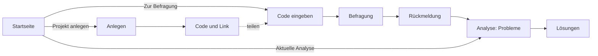

# Konzept v3: ROKIO

**Stand:** 05.11.2026 · **Status:** freigegeben, nach Prüfung jedes Schritts verschlankt (Abschnitt 9)
**Grundlage:** [`fallstudien/`](fallstudien/README.md) · Grundsätze in [`PROJEKT.md`](PROJEKT.md) §4 · Technik in [`TECHNIK.md`](TECHNIK.md)
**Löst ab:** [`KONZEPT_WORKFLOW.md`](KONZEPT_WORKFLOW.md) (Workflow v2)

---

## 1. Ablauf

| Seite | Route | ersetzt |
|---|---|---|
| Startseite | `/` | `/` |
| Anlegen | `/anlegen` | `/start` |
| Code eingeben | `/zugang` | – |
| Befragung | `/befragung/[code]` | `/mitmachen/[id]` |
| Analyse | `/analyse/[code]` | `/ergebnis/[id]` (Teil 1) |
| Lösungen | `/loesungen/[code]` | `/ergebnis/[id]` (Teil 2) |

Der Code ist die bisherige ID der Bestandsaufnahme (6 Zeichen ohne Verwechslungsgefahr, Demo: `HEIDE1`).

## 2. Startseite

1. **Hero:** ein Satz, was ROKIO tut. Buttons **Projekt anlegen** und **Zur Befragung** (Code-Feld), kleiner Link „Aktuelle Analyse“.
2. **Live-Karte:** animierte Übergabe-Karte, die von „heute“ auf „mit Lösungen“ umschaltet.
3. **So funktioniert es:** drei Schritte mit Zeitangabe, je ein Satz für Leitung und Team.
4. **Drei Beispiele:** Metallbau, Pflege, Mensa, je ein Satz und eine Lösung.

Vorher sehe ich mir einige Startseiten vergleichbarer Angebote an und übernehme Muster, keine Inhalte.

## 3. Anlegen (Leitung)

- **Betrieb:** Name, Branche, Größe, Website (optional), Leistungen und Ziel je ein Satz, Anrede Sie/du
- **Bereiche:** Chips mit Vorschlägen je Branche, je Bereich eine Stundensatz-Spanne
- **Deadline:** Datum und Uhrzeit der Ergebnisbesprechung, frei als „wann und wo“

**🧠 Vorbereitung** (ein KI-Aufruf):
- Den Website-Text liest der Server.
- Ergebnis: eine **Kurzbeschreibung**, **externe Beteiligte** (Kunde, Gäste, Angehörige …), **Aufgaben-Chips je Bereich** und **Rückfragen je Bereich**.
- Die Leitung kann Chips löschen und ergänzen.
- Danach: **Code und Link** (kopieren, WhatsApp).

## 4. Befragung (Beschäftigte)

Code → Einführung (Ziel und Deadline, zwei Sätze) → Bereich → Aufgaben-Chips des Bereichs + „Etwas anderes …“ → je Thema erzählen (Text oder Sprache) → 🧠 Spiegelung, höchstens eine Rückfrage aus dem Vorrat, Regler vorbelegt → Regler **Wie oft · Wie lange · Wie sehr bremst dich das?** · Zeile **„Betrifft die Übergabe von/an …“** (Bereich-Chips, von der KI vorbelegt) → bestätigen → **Mitsprache** (1–5) → Rückmeldung.

**Rückmeldung:**
- Satz 1 ist die Spiegelung.
- Satz 2 schreibt der Code nach Datenlage (erste Stimme / bisher allein / nicht allein).
- Dazu Fortschritt, Deadline und **Zur aktuellen Analyse**.

Freie Eingaben müssen funktionieren (seit PR #9 getestet). Texte in anderen Sprachen versteht die KI ohnehin, eine eigene Sprachwahl bauen wir nicht.

## 5. Analyse (nur Probleme)

**Erster Blick:**
- Kernzahl (Stunden/Woche, €/Jahr, „aus N Schätzungen“)
- **Übergabe-Karte**
- drei größte Handlungsfelder
- Mitsprache

**Zweiter Blick:**
- alle Handlungsfelder mit Sichtweisen, Unterschied und Stärken
- Klick auf eine Linie zeigt die Stimmen dazu
- **Profil** (Netzdiagramm, Achsen = Handlungsfelder, Wert = Ø „bremst“), falls Zeit bleibt

**Übergabe-Karte aus Daten:**
- Knoten = Bereiche plus externe Beteiligte.
- Jede Stimme hat `von`/`an`. Stimmen desselben Handlungsfelds mit demselben Paar ergeben eine Linie.
- Linienstärke = Zahl der Stimmen. Farbe: 1 grau, 2 orange, ab 3 Bruchstelle.
- Gezeichnet als SVG im Code.

## 6. Lösungen

**Erster Blick:**
- Übergabe-Karte mit Umschalter **heute / mit Lösungen**. Die Linien werden türkis und tragen den Lösungsnamen.
- Je Handlungsfeld eine Kachel: Name, ein Satz, Reife, Zeit zurück.

**Zweiter Blick je Lösung:**
- So läuft es (3 Schritte)
- Was es braucht
- Der KI-Kniff
- Wofür die Zeit frei wird
- Reife, Herkunft, erster Testlauf
- **Bauplan-Prompt** zum Kopieren

Darunter:
- **ein** Szenario-Regler („Wenn diese Zeitverluste um X % sinken“, Start 50 %, gekennzeichnet)
- „Erste Schritte“, zusammengestellt aus den Testläufen der Lösungen

**🧠 Lösungen erzeugen:**
- Läuft im Hintergrund nach jedem Ergänzen des Bilds, nur für neue Handlungsfelder, parallel.
- Grundlage: ein kleiner **Muster-Katalog** (`wissen/loesungsmuster.json`, ca. 12 Muster aus den Fallstudien) plus ROKI-Wissensauszug.
- Die KI passt ein Muster an den Betrieb an.
- Der Code prüft:
  - Herkunft nur mit gültiger `wissenId`,
  - keine Namen im Bauplan-Prompt.
- Für Heidekamp liegen die Lösungen als geprüfte Datei vor.

## 7. Daten

### 🛢 Migration

| Tabelle | Änderung |
|---|---|
| `bestandsaufnahmen` | + `website`, + `profil jsonb` (Kurzbeschreibung, Extern, Chips, Rückfragen) · `bereiche` wird JSON mit Stundensatz-Spanne je Bereich · `deadline text` statt `besprechung_am` · `stundensatz` und `zeitfresser` entfallen |
| `beitraege` | + `mitsprache smallint` · `bremst` wird optional (steckt jetzt je Punkt im JSON) |
| `gesamtbilder` | + `loesungen jsonb` (je Faden, mit Fingerabdruck des Fadens) |

RLS und Zugriff nur über den Server bleiben, wie sie sind. Die Testdaten werden neu eingespielt.

### Formate (`lib/typen.ts`)

- `Bereich { name, satzVon, satzBis }`. Gerechnet wird mit der Mitte, je nach Bereich der Person.
- `Profil { kurz, extern[], chips{}, rueckfragen{} }`
- `Punkt` + `bremst`, `von`, `an`
- `Faden` + `kurzname`
- `Loesung { fadenId, name, satz, schritte[3], braucht[], kniff, zeitFrei, art, reife, herkunft, wissenId, testlauf, bauplanPrompt }`

## 8. Reihenfolge

| # | Paket | Prüfpunkt |
|---|---|---|
| 1 | Migration, Typen, Testdaten Heidekamp aus Fallstudie 1, Rechnen je Bereich | Reset funktioniert, Typecheck grün |
| 2 | Anlegen mit 🧠 Vorbereitung | Heidekamp in 3 Minuten anlegbar |
| 3 | Befragung v3 | Marco und frei erfundene Themen laufen durch |
| 4 | Analyse mit Übergabe-Karte | Karte aus echten Daten |
| 5 | Lösungen mit Umschalter und Bauplan-Prompt | Wow-Moment steht |
| 6 | Startseite | in 10 Sekunden verstanden |
| 7 | Test auf dem Server, Demo-Modus, Pitch-Probe | |

**Wenn die Zeit knapp wird, zuerst streichen:**
1. Profil
2. Website lesen
3. Klick auf Linien

## 9. Prüfung: ist jeder Schritt gerechtfertigt?

| Schritt | Begründung | Ergebnis |
|---|---|---|
| Startseite mit zwei Buttons | Vorgabe von Sarah, erster Kontakt | bleibt |
| Live-Karte auf der Startseite | Wow ohne Text, zeigt das Produkt in 5 Sekunden | bleibt |
| Abschnitte „Ehrlich“ und „Abschluss mit Buttons“ | wiederholen nur, was schon da ist | **gestrichen** (ein Satz im Hero genügt) |
| „Für Leitung / für Team“ als eigener Block | passt in „So funktioniert es“ | **zusammengelegt** |
| Website lesen | ausdrücklich gewünscht, macht Chips betriebsspezifisch | bleibt (als Erstes streichbar) |
| Personenzahl je Bereich | nur für Fortschritt nötig, dafür reicht die Gesamtgröße | **gestrichen** |
| Deadline mit getrenntem Ort-Feld | ein Textfeld „wann und wo“ reicht | **vereinfacht** |
| Betriebsprofil mit Kette und Übergaben | Kanten entstehen aus den Stimmen; gebraucht werden nur Kurzbeschreibung und Externe | **verkleinert** |
| QR-Code zum Aushängen | bräuchte eine neue Abhängigkeit, Link und WhatsApp reichen | **gestrichen** |
| eigenes Code-Feld in der Datenbank | die bestehende ID ist schon der Code | **gestrichen** |
| Weiterleitung alter Routen | es gibt keine geteilten Links außerhalb des Teams | **gestrichen** |
| Aufgaben-Chips und Rückfragen je Bereich | ausdrücklich gewünscht: individuelle Fragen | bleibt |
| „Etwas anderes …“ | ausdrücklich gewünscht, darf nicht übergangen werden | bleibt |
| „Von wem / an wen“ je Thema | ohne diese Angabe gibt es keine echte Übergabe-Karte | bleibt (vorbelegt, ein Tipp) |
| „bremst“ je Thema | einzige Grundlage für das Profil und für Belastung ohne Zeitangabe | bleibt (ein Regler, ersetzt den bisherigen) |
| Mitsprache-Frage | misst den Kern von ROKIO (gehört werden), ein Tipp | bleibt |
| Sprachwahl für die Spracheingabe | Text in jeder Sprache versteht die KI schon | **gestrichen** |
| Stufen der Analyse (3/6/8 Beiträge) | für die Demo unnötig (Sarah) | **gestrichen**, Regel steht in `PROJEKT.md` |
| verlorene Zeit und Routine getrennt erfassen | bräuchte eine Zusatzfrage je Thema | **gestrichen** für den Prototyp, bleibt in den Fallstudien |
| Profil | gewünscht, aber nicht Kern des Pitches | bleibt als erstes Streichopfer |
| Szenario-Regler je Feld | ein Regler für alle sagt dasselbe | **vereinfacht** auf einen |
| Vision-Tabelle „ein Tag in einem Jahr“ | wäre ein weiterer KI-Text. „Wofür die Zeit frei wird“ je Lösung zeigt dasselbe | **gestrichen** |
| Fahrplan als eigener KI-Schritt | ergibt sich aus den Testläufen der Lösungen | **ohne KI**, aus vorhandenen Daten |
| Muster-Katalog | macht Lösungen zuverlässig und Reife ehrlich, statt frei erfunden | bleibt, klein (ca. 12) |
| eigene Spalte „loesungen_stand“ | der Fingerabdruck steckt in jeder Lösung | **gestrichen** |
| Präsentationsmodus | Analyse und Lösungen sind schon präsentierfähig | **gestrichen** |
| Beschluss eintragen (v2) | in v3 nicht mehr verlangt | UI entfällt, Tabelle bleibt unangetastet |
