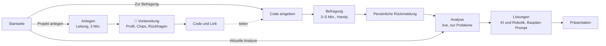

# Konzept v3: ROKIO

**Stand:** 05.11.2026 · **Status:** Entwurf zur Freigabe
**Grundlage:** [`fallstudien/`](fallstudien/README.md) · Grundsätze in [`PROJEKT.md`](PROJEKT.md) §4 · Technik in [`TECHNIK.md`](TECHNIK.md)
**Löst ab:** [`KONZEPT_WORKFLOW.md`](KONZEPT_WORKFLOW.md) (Workflow v2)

> Dieses Dokument beschreibt, **was** wir umbauen und **in welcher Reihenfolge**. Datenbankänderungen und neue KI-Schritte sind markiert (🛢 / 🧠). Sie werden erst nach Freigabe gebaut.

---

## 1. Der Ablauf auf einen Blick

| Seite | Route (neu) | ersetzt | Wer |
|---|---|---|---|
| Startseite | `/` | `/` | alle |
| Anlegen | `/anlegen` | `/start` | Leitung |
| Code eingeben | `/zugang` | – | Beschäftigte |
| Befragung | `/befragung/[code]` | `/mitmachen/[id]` | Beschäftigte |
| Analyse | `/analyse/[code]` | `/ergebnis/[id]` (Teil 1) | alle mit Code |
| Lösungen | `/loesungen/[code]` | `/ergebnis/[id]` (Teil 2) | alle mit Code |
| Präsentation | `/loesungen/[code]?folien` | Präsentationsmodus | Besprechung |

Alte Routen leiten auf die neuen weiter, damit geteilte Links weiter funktionieren.

---

## 2. Startseite

**Aufgabe:** In 10 Sekunden verstehen, was ROKIO ist. Danach nur noch zwei Entscheidungen.

| Abschnitt | Inhalt | Wirkung |
|---|---|---|
| **Hero** | Überschrift (Entwurf): „Ihre Leute wissen, wo es hakt. ROKIO macht es sichtbar – und zeigt, wie KI und Robotik helfen.“ Zwei Buttons: **Projekt anlegen** · **Zur Befragung** (Code). Kleiner Link: „Aktuelle Analyse ansehen“. | sofort klar, wer wo klickt |
| **Live-Bild** | Eine animierte Übergabe-Karte (Heidekamp): Die Linien werden orange, dann schaltet sie auf „mit Lösungen“ und wird türkis. | Wow ohne Text |
| **So funktioniert es** | drei Schritte mit Zeitangabe: Anlegen (3 Min.) · Alle erzählen (5 Min. am Handy) · Analyse und Lösungen (live) | Aufwand ist greifbar |
| **Für die Leitung / für das Team** | zwei Spalten: was jede Seite davon hat | Bottom-up wird sichtbar |
| **Drei Beispiele** | Karten aus den Fallstudien: Metallbau, Pflege, Mensa, je mit einem Satz und einer Lösung | Branchenbreite |
| **Ehrlich** | Reife und Herkunft, „von ROKI geprüft“, lokale KI als Ziel | Vertrauen |
| **Abschluss** | die beiden Buttons noch einmal | |

Vor dem Bau schauen wir uns 5 bis 6 Startseiten von Produkten an, die Ähnliches lösen (Befragung, Prozessanalyse, KI für KMU), und übernehmen Muster, keine Inhalte. Gestaltung nach `DESIGN.md` mit Rubik, Navy, Türkis und Orange sparsam.

---

## 3. Anlegen (Leitung)

**Eingaben** (eine Seite, drei Blöcke):

1. **Betrieb:** Name, Branche (5 ROKI-Branchen), Größe, Website (optional), Leistungen in einem Satz, Ziel in einem Satz, Anrede Sie/du.
2. **Bereiche:** Chips mit Vorschlägen je Branche, frei ergänzbar. Je Bereich: Anzahl Personen und **Stundensatz-Spanne** (zwei Regler, Arbeitgeberkosten pro Stunde, Hinweis „grobe Schätzung, keine Einzellöhne“).
3. **Deadline:** Datum, Uhrzeit und Ort der Ergebnisbesprechung. Diese Angabe sehen alle.

🧠 **Vorbereitung** (ein KI-Aufruf, etwa 5–10 s, mit Ladeanzeige „ROKIO lernt Ihren Betrieb kennen“):
- **Website:** Der Server liest den Text der Startseite (ohne neue Abhängigkeit, mit Zeitlimit, ohne Bilder). Gelingt das nicht, reicht der Leistungssatz.
- **Ergebnis:**
  - Betriebsprofil (Kette der Arbeit, typische Übergaben, externe Beteiligte wie Kunde, Gäste oder Angehörige),
  - **Aufgaben-Chips je Bereich** (5–6),
  - **Rückfragen-Vorrat je Bereich** (3–5).
- Die Leitung sieht die Chips und kann sie ändern. Danach erscheinen **Code und Link** zum Teilen (Kopieren, WhatsApp, QR für den Aushang).

**Code:** 6 Zeichen ohne Verwechslungsgefahr (z. B. `HDK-4R7`). In der Demo hat Heidekamp den festen Code `HEIDE1`.

---

## 4. Befragung (Beschäftigte)

| Schritt | Was passiert | Neu gegenüber v2 |
|---|---|---|
| Code | eingeben oder über Link schon gesetzt | neu |
| Einführung | zwei Sätze: Ziel der Leitung und Deadline, in der gewählten Anrede | neu (statt Freitext der Leitung) |
| Bereich | Chips aus dem Anlegen | wie v2, ohne „Mein Bereich darf genannt werden“ |
| Aufgaben | **Chips je Bereich**, betriebsspezifisch, bis zu 3. Dazu **„Etwas anderes …“**: Eingabefeld, das wie ein Chip weiterläuft. | Chips je Bereich statt für alle gleich |
| Erzählen | je Thema: Text oder Sprache (Sprache auch in anderen Sprachen) | Sprachwahl |
| 🧠 Verstehen | Spiegelung in einem Satz, höchstens eine Rückfrage aus dem Vorrat, an die Geschichte angepasst. Die Regler werden vorbelegt. **Neu:** Die KI schlägt vor, von welchem Bereich das Problem kommt bzw. an welchen es geht. | Vorrat, Übergabe-Vorschlag |
| Regler | Wie oft · Wie lange · **Wie sehr bremst dich das?** (je Thema) · **Von wem / an wen?** (Chips der Bereiche, vorbelegt) | „bremst“ je Thema statt je Beitrag; Übergabe |
| Bestätigen | „So habe ich dich verstanden“ (wie v2) | – |
| Mitsprache | eine Frage, 1–5 | neu |
| Rückmeldung | Satz 1 aus der Spiegelung (individuell). Satz 2 im Code nach Datenlage: erste Stimme · bisher allein · „nicht allein“ mit Bereichen. Dazu Fortschritt, Deadline, **Zur aktuellen Analyse**. | Satz 2 nach Datenlage (teilweise schon gebaut) |

**Freie Eingaben sind Pflicht:** Wer etwas erzählt, das in keinem Chip und keinen Testdaten vorkommt, bekommt eine passende Spiegelung, eine sinnvolle Rückfrage und landet in einem passenden oder neuen Handlungsfeld (seit PR #9 getestet).

---

## 5. Analyse (live, nur Probleme)

**Erster Blick:**
1. Kernzahl: Stunden pro Woche und Euro pro Jahr, mit dem Satz „aus N Schätzungen der Beschäftigten“
2. **Übergabe-Karte** (siehe unten)
3. die drei größten Handlungsfelder als Kacheln
4. Mitsprache-Wert

**Zweiter Blick (aufklappbar):**
- alle Handlungsfelder mit Sichtweisen und Unterschied
- verlorene Zeit und verlagerbare Routine getrennt
- Stärken
- **Profil:** Netzdiagramm mit 3 bis 6 Achsen = Handlungsfelder, Wert = Ø „bremst“

**Was wann erscheint:** In der Demo ist alles sichtbar. Für echte Betriebe gelten Stufen ab 3, 6 und 8 Beiträgen (`PROJEKT.md` §10).

### Übergabe-Karte: wie sie aus Daten entsteht

- **Knoten:** die Bereiche aus dem Anlegen plus externe Beteiligte aus dem Betriebsprofil (gestrichelt).
- **Kanten:** Jeder Punkt hat `von` und `an` (aus dem Regler „Von wem / an wen?“). Punkte desselben Handlungsfelds mit demselben Paar ergeben eine Kante.
  - **Beschriftung:** Kurzname des Handlungsfelds.
  - **Linienstärke:** Zahl der Stimmen.
  - **Farbe:** 1 Stimme grau, 2 orange, ab 3 Bruchstelle.
- **Punkte ohne Übergabe** (innerhalb eines Bereichs) werden zu einer Schleife am Knoten.
- **Layout im Code:** Knoten auf einem Kreis oder Raster nach der Kette aus dem Betriebsprofil, gezeichnet als SVG, ohne neue Abhängigkeit.
- **Klick auf eine Kante** öffnet die Stimmen dazu, umformuliert und ohne Namen.

---

## 6. Lösungen (eigene Seite)

**Erster Blick:**
- **Übergabe-Karte mit Umschalter heute / mit Lösungen.** Beim Umschalten werden die Linien türkis, und an jeder steht der Lösungsname. Das ist der Wow-Moment im Pitch.
- **Kacheln je Handlungsfeld:** Name der Lösung, ein Satz, Reife-Symbol, „≈ X Std./Woche zurück“ (Szenario).

**Zweiter Blick je Lösung**, fester Aufbau:

| Baustein | Inhalt |
|---|---|
| So läuft es | 3 Schritte, konkret in diesem Betrieb |
| Was es braucht | Daten, Geräte, Absprachen |
| Der KI-Kniff | was die KI hier kann, das Liste oder Programm allein nicht können |
| Wofür die Zeit frei wird | ohne Personalabbau |
| Reife · Herkunft · erster Testlauf | „von ROKI geprüft“ nur mit `wissenId` |
| **Bauplan-Prompt** | kopierfertig, aus Betriebsprofil und Stimmen, ohne Namen |

Darunter: **Szenario-Regler** je Feld (Start 50 %, gekennzeichnet), Summe in Stunden und Euro, Vision „ein Tag in einem Jahr“ als Tabelle, Fahrplan (2 Wochen / 3 Monate / 12 Monate).

🧠 **Lösungen erzeugen:**
- **Zeitpunkt:** im Hintergrund nach jedem Ergänzen des Bilds, nur für neue oder veränderte Handlungsfelder, parallel je Feld. Die Seite liest nur fertige Ergebnisse und wartet nie auf die KI.
- **Grundlage:** ein **Muster-Katalog** (`wissen/loesungsmuster.json`, etwa 15 Muster aus den drei Fallstudien, z. B. „Änderungs-Agent“, „Sprechen statt Schreiben“, „Mengen-Prognose“) plus ROKI-Wissensauszug.
- **Vorgehen:** Die KI wählt ein Muster und passt es an den Betrieb an. Gibt es kein passendes Muster, darf sie ein neues vorschlagen, dann immer „nicht von ROKI geprüft“ und mit Reife ◐ oder ○.
- **Prüfung im Code:**
  - Herkunft nur mit gültiger `wissenId`,
  - Bauplan-Prompt ohne Namen und Zahlen aus Einzelantworten,
  - keine Anbieter.
- **Demo:** Für Heidekamp liegen die Lösungen als geprüfte Datei vor (wie das Startbild), damit „Demo zurücksetzen“ sofort funktioniert.

---

## 7. Daten

### 🛢 Datenbankänderungen (Migration, Freigabe nötig)

| Tabelle | Änderung | Warum |
|---|---|---|
| `bestandsaufnahmen` | `code` (eindeutig) · `website` · `betriebsprofil jsonb` · `bereiche` wird JSON mit Personen und Stundensatz-Spanne je Bereich · `deadline timestamptz` und `deadline_ort` statt `besprechung_am` · `stundensatz` entfällt (steckt je Bereich) | Anlegen v3 |
| `beitraege` | `mitsprache smallint` · in `punkte`: `bremst`, `von`, `an` je Punkt; Spalte `bremst` entfällt | Profil und Übergabe-Karte |
| `gesamtbilder` | `loesungen jsonb` und `loesungen_stand` (welche Fäden schon berechnet sind) | Lösungsseite |
| `beschluesse` | bleibt | – |

Weiterhin gilt: RLS an, kein Zugriff für `anon`/`authenticated`, nur der Server liest und schreibt. Die Migration ändert bestehende Spalten. Die Testdaten werden dabei neu eingespielt, Live-Daten gibt es noch keine.

### Neue und geänderte Formate (`lib/typen.ts`)

- `Bereich { name, personen, satzVon, satzBis }` · Rechnen mit der Mitte
- `Betriebsprofil { kette[], uebergaben[], extern[], chips{bereich: string[]}, rueckfragen{bereich: string[]} }`
- `Punkt` + `bremst 1–5`, `von`, `an` (Bereichsname, extern oder null)
- `Faden` + `kurzname` (2–3 Wörter für Karte und Achse)
- `Loesung { fadenId, name, vision, schritte[3], braucht[], kniff, zeitFrei, art, reife, herkunft, wissenId, testlauf, bauplanPrompt, musterId }`

**Rechnen:** `euroProJahr` nimmt den Satz aus dem Bereich der Person. Szenario = Stunden × Annahme, im Code.

---

## 8. KI-Schritte

| # | Schritt | Wann | Dauer (Ziel) | Neu? |
|---|---|---|---|---|
| ① | Vorbereiten: Betriebsprofil, Chips, Rückfragen | beim Anlegen | ≤ 10 s | 🧠 ersetzt „Zeitfresser“ |
| ② | Verstehen: Spiegelung, Werte, Rückfrage, `von`/`an` | je Thema | ≤ 5 s | erweitert |
| ③ | Zusammenführen (erstes Bild) | einmal | ≤ 35 s | + `kurzname` |
| ③b | Ergänzen (zuordnen, neue Fäden) | je Beitrag | 3–14 s | seit PR #9 |
| ④ | Lösungen je Faden | im Hintergrund nach ③/③b | ≤ 20 s je Faden, parallel | 🧠 neu |

**Prompt-Regeln für alle Schritte:**
- Anrede aus dem Anlegen, sachliche Feldnamen.
- Keine Namen, keine Gesundheitsangaben.
- Keine Anbieter.
- Zahlen nur aus dem Code.

Sprachaufnahmen in anderen Sprachen übersetzt Schritt ② nach Deutsch für die Analyse. Die Spiegelung geht in der Sprache der Person zurück.

---

## 9. Reihenfolge und Schnittlinie

| # | Paket | Ergebnis | Abhängig von |
|---|---|---|---|
| 1 | 🛢 Migration und Typen, Testdaten Heidekamp aus Fallstudie 1 | Daten stehen, Reset funktioniert | Freigabe |
| 2 | Anlegen und 🧠 Vorbereitung, Code | Heidekamp in 3 Minuten anlegbar | 1 |
| 3 | Befragung v3 (Code, Chips je Bereich, „Etwas anderes“, bremst/von/an, Mitsprache, Rückmeldung) | Marco live durchspielbar | 1, 2 |
| 4 | Analyse mit Übergabe-Karte | Karte aus echten Daten | 3 |
| 5 | 🧠 Lösungen, Muster-Katalog, Lösungsseite mit Umschalter und Bauplan-Prompt | Wow-Moment | 4 |
| 6 | Startseite | erster Eindruck | parallel ab 1 möglich |
| 7 | Feinschliff, Demo-Modus, Test auf dem Server, Pitch-Probe | | alle |

**Schnittlinie**, falls die Zeit knapp wird (in dieser Reihenfolge streichen):
1. Profil-Netzdiagramm (die Kacheln reichen)
2. Sprachwahl in der Befragung
3. Website lesen (der Leistungssatz reicht)
4. Präsentationsmodus

**Nicht verhandelbar:** Übergabe-Karte mit Umschalter, Lösungen mit Bauplan-Prompt, freie Eingaben funktionieren, Startseite.

---

## 10. Entscheidungen, die ich brauche

1. **🛢 Migration** wie in Abschnitt 7: Freigabe?
2. **Code-Format:** 6 Zeichen (z. B. `HDK-4R7`), Demo `HEIDE1`. Passt das?
3. **Muster-Katalog** als neue Datei `wissen/loesungsmuster.json` (alle Muster „nicht von ROKI geprüft“, außer sie verweisen auf den Wissensauszug). Passt das?
4. **Sprachwahl in der Befragung:** Ich würde sie anbieten, wenn Zeit bleibt (Deutsch, Englisch, Türkisch, Ukrainisch, Arabisch über die Spracheingabe des Browsers). Passt das?
