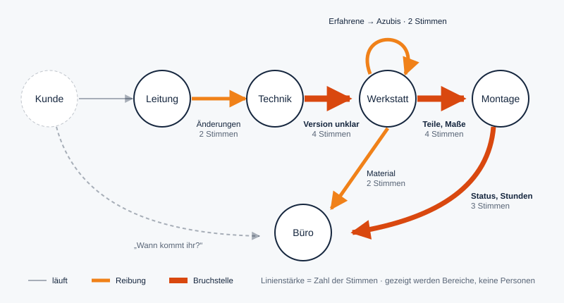
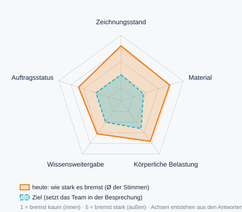

# Fallstudie 1: Metallbau Heidekamp

**Stand:** 05.11.2026 · **Status:** Entwurf, 2. Fassung
**Branche:** Produktion und Handwerk · **Betrieb:** fiktiv, alle Personen erfunden
**Gehört zu:** [`PROJEKT.md`](../PROJEKT.md). Baut auf [`ROwAI_Personas_Metallbau.md`](../ROwAI_Personas_Metallbau.md) und [`DEMO_BETRIEBE.md`](../DEMO_BETRIEBE.md) auf.

Das Dokument hat zwei Teile:
- **Teil A** zeigt, was der Betrieb in ROKIO sieht: erst den schnellen Überblick, dann die Tiefe.
- **Teil B** ist unser Hintergrundwissen (Personen, Rohdaten, Quellen). Es erscheint so nicht in der App.

> **Kennzeichnung:** 🟢 belegt (Quelle in B8) · 🔵 ROKI geprüft (geprüfte ROKI-Recherche im Repo) · ⚪ Annahme für den fiktiven Betrieb · 🟠 Szenario mit genannter Annahme

---

# Teil A: Das Ergebnis, wie ROKIO es zeigt

ROKIO zeigt das Ergebnis auf drei Seiten nacheinander:

| Seite | Wann | Wirkung |
|---|---|---|
| **A1 Persönliche Rückmeldung** | direkt nach der eigenen Befragung | „Ich wurde verstanden.“ |
| **A2 Analyse** | jederzeit über den dritten Einstieg „Aktuelle Analyse“; sie wächst mit jeder Antwort | „So steht es um unseren Betrieb.“ Es werden nur Probleme gezeigt, noch keine Lösungen. |
| **A3 Lösungen** | eigene Seite, Übergang aus der Analyse | „Das kann sich ändern.“ |

Die Präsentation für die Besprechung kommt zuletzt und setzt sich aus A2 und A3 zusammen. Alle Texte folgen der Anrede, die die Leitung beim Anlegen gewählt hat. Heidekamp hat „du“ gewählt.

## A1. Persönliche Rückmeldung (direkt nach der Befragung)

**Satz 1** bezieht sich auf das, was diese Person erzählt hat. Die KI schreibt ihn neu für jede Person, nie als Textbaustein.

**Satz 2** beschreibt den aktuellen Stand der Ergebnisse und hängt davon ab, wie viele Antworten schon da sind:

| Situation | Beispiel: Werkstattleiter, Anrede „du“ | Gleiche Situation, Anrede „Sie“ |
|---|---|---|
| **Erste Person überhaupt** | „Dass du vor jedem Auftrag klären musst, welche Zeichnung gilt, ist jetzt festgehalten. Du bist die erste Stimme. Sobald weitere dazukommen, siehst du in der Analyse, wer Ähnliches erlebt.“ | „Dass Sie vor jedem Auftrag klären müssen … Sie sind die erste Stimme …“ |
| **Thema bisher nur von dieser Person** | „… ist jetzt festgehalten. Bisher hat das niemand sonst genannt. Es geht als eigenes Thema in die Analyse ein. Gerade einzelne Stimmen zeigen oft, was sonst übersehen wird.“ | analog |
| **Andere teilen das Thema** | „… ist jetzt festgehalten. **Du bist nicht allein:** Vier Personen aus Technik, Montage und Leitung beschreiben dasselbe. Es ist eines der zwei größten Themen im Betrieb.“ | analog |
| **Andere teilen es, aber ein Bereich ist noch zu klein** | „… Drei weitere Personen aus anderen Bereichen beschreiben dasselbe.“ (Bereiche werden erst ab der Mindestanzahl genannt) | analog |

Darunter stehen immer drei Angaben:
- der Fortschritt („9 von 22 haben teilgenommen“),
- die Deadline („Ergebnisbesprechung am 3. Dezember, 7:30 Uhr“),
- der Button **„Zur aktuellen Analyse“**.

## A2. Analyse (live, wächst mit jeder Antwort)

Die Analyse zeigt **nur Probleme**: wo es hakt, wer es spürt und was es kostet. Lösungen folgen erst auf der nächsten Seite.

**Was wann erscheint:**

| Beiträge | Was die Analyse zeigt |
|---|---|
| 1–2 | Fortschritt, Deadline und die bisher genannten Themen als einfache Liste. Noch keine Zahlen über Personen hinweg, kein Diagramm. |
| ab 3 (Mindestanzahl) | Handlungsfelder mit Kernzahl in Stunden und Euro |
| ab 6, mindestens 3 Bereiche | **Übergabe-Karte** |
| ab 8 Profil-Bewertungen | **Handlungsfeld-Profil** |
| alle oder Deadline erreicht | vollständige Analyse, die Lösungsseite wird mit dem vollen Stand neu berechnet |

Wer später antwortet, bekommt also mehr zurück: eine genauere Rückmeldung in A1 und eine tiefere Analyse.

### Erster Blick (30 Sekunden)

**1. Die Kernzahl**

> **25,6 Stunden pro Woche** gehen an fünf Übergaben verloren. Das sind **zwei Drittel einer Vollzeitstelle**, ermittelt aus 16 Aussagen aus fünf Bereichen.

**2. Die Übergabe-Karte: wo Informationen zwischen Bereichen verloren gehen**



Die Karte zeigt Bereiche, keine Personen. Sie zeigt Abläufe, die nicht funktionieren, keine Fehler Einzelner. Ein Klick auf eine Linie öffnet die Stimmen dazu.

**3. Die drei größten Handlungsfelder**

| Handlungsfeld | Gemeinsame Aufgabe | Stimmen aus | Std./Woche | €/Jahr |
|---|---|---|---|---|
| **Materialverfügbarkeit** | Jeder weiß, was da ist und was mitmuss. | Werkstatt, Büro, Montage | 8,4 | ≈ 16.200 |
| **Zeichnungsstand und Änderungen** | Alle arbeiten nach derselben freigegebenen Zeichnung. | Leitung, Technik, Werkstatt, Montage | 7,3 | ≈ 15.400 |
| **Auftragsstatus und Rückmeldungen** | Niemand muss anrufen, um zu wissen, wo ein Auftrag steht. | Büro, Montage | 5,8 | ≈ 10.800 |

**4. Mitsprache**

> **„Meine Vorschläge kommen an, und es passiert etwas.“**
> Team: **2,1** von 5

Diese eine Frage stellt ROKIO in jedem Betrieb. Sie misst, worum es im Kern geht: ob die Beschäftigten gehört werden.

### Zweiter Blick: für alle, die tiefer einsteigen

#### Alle fünf Handlungsfelder

| Handlungsfeld | Was die Stimmen sagen | Systemische Ursache | Std./Woche |
|---|---|---|---|
| **Materialverfügbarkeit** | Material wird gesucht, Eilbestellungen sind nötig, auf der Baustelle fehlen Teile. | Der Bestand ist nirgends erfasst, gepackt wird ohne Liste. | 8,4 |
| **Zeichnungsstand und Änderungen** | Zeichnungen werden mehrfach geändert, die Werkstatt klärt die Version, die Montage arbeitet nach. | Änderungen kommen mündlich in den Betrieb, und kein Ort zeigt die gültige Version. | 7,3 |
| **Auftragsstatus und Rückmeldungen** | Kunden fragen im Büro nach, das Büro ruft auf der Baustelle an, Stunden kommen erst freitags. | Einsatzplan und Stunden liegen nicht digital vor. | 5,8 |
| **Wissensweitergabe** | Erfahrene werden ständig unterbrochen, Auszubildende warten auf Antworten. | Erfahrungswissen ist nicht festgehalten, und es gibt keine feste Zeit für Anleitung. | 4,2 |
| **Körperliche Belastung und Serienarbeit** | Gleichförmiges Schweißen von Serienteilen, schweres Tragen auf der Baustelle | Serienteile werden wie Einzelstücke gefertigt, auf der Baustelle fehlen Hebehilfen. | ≈ 8 verlagerbar |

**Unterschiedliche Sichtweisen** zeigt ROKIO ausdrücklich. Ein Beispiel aus dem Zeichnungsstand:
- Die Leitung hält es für ein Aufmaßproblem.
- Die Werkstatt sagt: „Die Zeichnungen fehlen nicht. Wir erkennen nur nicht, welche aktuell ist.“

**Genannte Stärken:**
- „In der Werkstatt hilft jeder jedem.“
- „Die Montagetrupps sind eingespielt.“
- „Gewendelte Treppen können nicht viele.“

**Zwei Arten von Zeit:**
- **Verlorene Zeit** (Suchen, Klären, Nacharbeiten): 25,6 Std./Woche. Sie wird **abgebaut**.
- **Routinezeit** (Serienschweißen, Angebote abtippen): ≈ 14 Std./Woche. Sie wird an Maschine oder KI **verlagert**.

Beides wird getrennt ausgewiesen, damit keine Zahl übertrieben wirkt.

#### Handlungsfeld-Profil



**Die Achsen entstehen aus den Antworten.** Jedes Handlungsfeld, das sich aus den Stimmen ergibt, wird eine Achse. Bei Heidekamp sind es fünf, in einem anderen Betrieb können es drei oder sechs sein. Niemand gibt sie vor, auch nicht die Leitung.

**Der Wert** ist der Durchschnitt des Reglers „Wie sehr bremst dich das?“ über alle Stimmen in diesem Feld. Die Rechnung macht der Code. Es gibt keine zusätzlichen Fragen.

**So liest man es:** Je weiter außen, desto stärker bremst das Feld im Alltag. Orange zeigt den Stand heute, Türkis das Ziel, das das Team in der Besprechung festlegt.

| Handlungsfeld | bremst heute (Ø) ⚪ | Stimmen |
|---|---|---|
| Zeichnungsstand und Änderungen | 4,2 | 7 |
| Materialverfügbarkeit | 3,9 | 4 |
| Körperliche Belastung und Serienarbeit | 3,8 | 2 |
| Auftragsstatus und Rückmeldungen | 3,4 | 3 |
| Wissensweitergabe | 3,1 | 2 |

Die Mitsprache-Frage („Meine Vorschläge kommen an, und es passiert etwas.“) steht nicht im Profil. Sie hat ihre eigene Kennzahl im ersten Blick.

Am Ende der Analyse steht ein Button: **„Was sich ändern kann →“**

---

## A3. Lösungen (eigene Seite)

### Erster Blick: die Übergabe-Karte, nachher

Dieselbe Karte wie in der Analyse, mit einem Umschalter **heute / mit Lösungen**. Beim Umschalten werden die orangen Linien türkis, und an jeder steht der Name der Lösung, zum Beispiel „Änderungs-Agent“ an der Linie Technik → Werkstatt. Darunter eine Kachel pro Handlungsfeld, jede mit drei Angaben:
- **Name der Lösung** und ein Satz, was sich ändert,
- **Reife** als Symbol,
- **Zeit zurück** als Szenario (z. B. „≈ 4 Std./Woche“).

Ein Klick auf eine Kachel öffnet den zweiten Blick.

### Zweiter Blick: jede Lösung im Detail

Jede Lösung hat denselben Aufbau, damit man sie in einer Minute versteht:

| Baustein | Frage, die er beantwortet |
|---|---|
| **So läuft es** | Wie sieht der Alltag mit der Lösung aus? Drei Schritte |
| **Was es braucht** | Daten, Geräte, Absprachen: alles, was vorher da sein muss |
| **Der KI-Kniff** | Was kann die KI hier, das eine Liste oder ein Programm allein nicht kann? |
| **Wofür die Zeit frei wird** | Wohin die gewonnene Zeit geht. Es wird niemand ersetzt. |
| **Reife · Herkunft · erster Testlauf** | Wie erprobt, wie belegt, wie klein anfangen? |
| **Bauplan-Prompt** | kopierfertig, aus den Daten dieses Betriebs |

**Reife:** ● heute im Einsatz · ◐ Bausteine verfügbar, als Gesamtlösung ein Pilot · ○ Forschung

---

#### Materialverfügbarkeit → **Lager mit Gedächtnis**
*Das Lager weiß, was da ist. Der Transporter weiß, was fehlt.*

**So läuft es**
1. Wer etwas entnimmt, sagt es dem Handy am Regal: „Zwei Stangen Flachstahl 40 × 8, Auftrag Müller.“
2. Die KI kennt die Stücklisten der nächsten drei Wochen. Sie meldet, was knapp wird, und legt dem Büro einen fertigen Bestellvorschlag hin.
3. Vor der Abfahrt fotografiert der Trupp die Ladung. Die KI vergleicht mit dem, was laut Zeichnung mitmuss: „Dübelsatz M12 fehlt.“

**Was es braucht:** Stücklisten als Datei (aus dem Zeichenprogramm), ein Handy oder Tablet am Lager, feste Lagerplätze, eine Startinventur der wichtigsten Materialgruppe.

**Der KI-Kniff:** Niemand muss Formulare ausfüllen. Die KI versteht gesprochene Werkstattsprache („zwei Stangen Vierzig-Acht“), und sie leitet aus der Zeichnung ab, was an Kleinteilen gebraucht wird. Das steht in keiner Liste.

**Wofür die Zeit frei wird:** Die Montage arbeitet, statt zurückzufahren. Das Büro bestellt geplant statt eilig.

Reife ◐ · nicht von ROKI geprüft · Ob die Bilderkennung bei Profilen und Kleinteilen zuverlässig ist, wird im Testlauf geprüft.
**Erster Testlauf:** Flachstahl und ein Montagetrupp, vier Wochen.

---

#### Zeichnungsstand und Änderungen → **Änderungs-Agent**
*Eine Änderung wird einmal gesagt und ist dann überall richtig.*

**So läuft es**
1. Die Leitung spricht die Änderung beim Kunden ins Handy: „Geländer Müller 5 cm höher, Handlauf Edelstahl.“ Eine weitergeleitete E-Mail geht genauso.
2. Die KI findet den Auftrag und die betroffenen Positionen und schreibt einen Änderungsentwurf. Die Technik zeichnet um und gibt mit einem Klick frei.
3. Die Werkstatt sieht nur noch die gültige Version. Auf jedem Ausdruck steht ein QR-Code, und beim Scannen erscheint „gültig“ oder „ersetzt durch V3“.

**Was es braucht:** Zeichnungen an einem gemeinsamen Ablageort statt nur als Ausdruck, eine Person, die freigibt, ein Bildschirm oder Tablet in der Werkstatt.

**Der KI-Kniff:** Die KI macht aus einem beiläufigen Satz am Telefon einen eindeutigen Änderungsauftrag: welcher Kunde, welches Bauteil, welche Position, alte und neue Werte. Bisher ging genau diese Übersetzung zwischen Kunde, Leitung und Technik verloren.

**Dazu der Aufmaß-Assistent:** Beim Aufmaß fragt er nach, was für den Bauteiltyp noch fehlt („Gewendelte Treppe: Geschosshöhe fehlt“), und vergleicht mit früheren Aufträgen.

**Wofür die Zeit frei wird:** Die Werkstatt fängt an, statt zu klären. Die Technik zeichnet einmal statt dreimal.

Reife ◐ · nicht von ROKI geprüft · Die Bausteine (Spracherkennung, Sprachmodelle, Versionsverwaltung) sind verfügbar, die Kombination wäre ein Pilot. Raumscans mit dem Smartphone reichen für Angebote, nicht für Maße unter etwa ±5 mm 🟢.
**Erster Testlauf:** vier Wochen lang alle Änderungen nur eingesprochen.

---

#### Auftragsstatus und Rückmeldungen → **Auftrags-Assistent**
*Niemand muss anrufen, um zu wissen, wo ein Auftrag steht.*

**So läuft es**
1. Ruft ein Kunde an, beantwortet ein Sprachassistent „Wann kommt ihr?“ aus dem Einsatzplan. Alles Neue gibt er als Zusammenfassung ans Büro.
2. Nach dem Einsatz spricht der Trupp im Auto ein: „Müller, 7:30 bis 15 Uhr, Geländer gesetzt, zwei Dübel nachgebohrt.“ Daraus entstehen am selben Tag Stundennachweis und Rechnungsentwurf.
3. Aus Aufmaß, Fotos und früheren Angeboten entsteht ein Angebotsentwurf, den die Leitung nur noch prüft.

**Was es braucht:** einen digitalen Einsatzplan (gemeinsamer Kalender reicht), eine Telefonnummer, die an den Assistenten weiterleiten kann, frühere Angebote als Dateien.

**Der KI-Kniff:** Der Assistent versteht frei gesprochene Fragen und Berichte. Er trennt Routine („Wann kommt ihr?“) von Neuem („Wir wollen noch ein Tor dazu“), und nur das Neue landet beim Menschen.

**Wofür die Zeit frei wird:** Das Büro kümmert sich um Kunden mit echten Anliegen. Die Leitung hat ihre Abende zurück.

Reife ● bis ◐ · nicht von ROKI geprüft
**Erster Testlauf:** zwei Wochen zählen, wie viele Anrufe Statusfragen sind. Danach ein Trupp mit Sprachbericht.

---

#### Wissensweitergabe → **Werkstatt-Wissensassistent**
*Was die Erfahrenen wissen, bleibt im Betrieb und ist in Sekunden abrufbar.*

**So läuft es**
1. Der Altgeselle erklärt beim Arbeiten in kurzen Sprach- oder Videonotizen, zum Beispiel: „So reiße ich die Wange einer gewendelten Treppe an.“
2. Die KI macht daraus Schritt-für-Schritt-Karten. Der Altgeselle prüft und gibt frei.
3. Auszubildende fragen an der Werkbank per Sprache. Der Assistent antwortet nur aus freigegebenen Karten und nennt die Quelle. Weiß er es nicht, landet die Frage in der festen Anleitungszeit.

**Was es braucht:** ein Handy mit Halterung zum Aufnehmen, eine feste Stunde pro Woche für den Altgesellen, einen KI-Assistenten mit Projektablage (Bauplan-Prompt unten).

**Der KI-Kniff:** Aus fünf Minuten Erzählen wird eine saubere Arbeitskarte. Kein Handbuch muss geschrieben werden, und die Antworten beziehen sich nur auf geprüftes Wissen aus dem eigenen Betrieb.

**Wofür die Zeit frei wird:** Der Altgeselle arbeitet ungestört und gibt sein Wissen geordnet weiter. Auszubildende kommen ohne Warten voran.

Reife ◐ · nicht von ROKI geprüft
**Erster Testlauf:** zehn Karten zu einem Bauteil, vier Wochen.

---

#### Körperliche Belastung und Serienarbeit → **Schweiß-Cobot ohne Programmierung**
*Serienteile schweißt der Cobot. Die Fachkraft baut die Sonderanfertigung.*

**So läuft es**
1. Der Geselle legt Pfosten, Stäbe oder Konsolen in eine Vorrichtung.
2. Ein Sensor erkennt die Naht, und die Roboterbahn entsteht ohne Programmierung 🟢.
3. Währenddessen arbeitet der Geselle an der gewendelten Treppe.

**Dazu für die Montage:** Exoskelette für Überkopfarbeit und Tragen, freiwillig und nach Anprobe.

**Was es braucht:** eine Vorrichtung für die Serienteile, Bauteile mit gleichbleibenden Toleranzen (vorher messen 🟢), eine Risikobeurteilung, Platz in der Werkstatt, einen Miet- oder Testtag.

**Der KI-Kniff:** Bisher lohnten sich Roboter nur bei großen Stückzahlen, weil jemand sie programmieren musste. Die Nahterkennung plant die Bahn selbst. Damit wird der Cobot auch für 24 Pfosten interessant.

**Wofür die Zeit frei wird:** Sonderanfertigungen, die nicht jeder Betrieb kann, und weniger gleichförmige Belastung für die Schweißer.

Reife: Cobot-Schweißen ● 🔵 (Robotertypen 3.3: typische Anwendung; Integration und Risikobeurteilung bestimmen den Aufwand) · Nahterkennung ohne Programmierung ◐ (2026 ausgezeichnet, neu am Markt 🟢) · Exoskelette ● 🔵 (Robotertypen 3.13: Nutzen hängt von Tätigkeit und Passform ab).
**Erster Testlauf:** ein Testtag mit eigenen Pfosten, Exoskelette zwei Wochen im Montageteam.
**Bewusst nicht vorgeschlagen:** Humanoide Roboter. Sie sind noch in einer frühen Nachweisphase 🔵 (Robotertypen 3.14).

---

### Bauplan-Prompt: die Lösung selbst einrichten

Zu **jeder** KI-Lösung gibt ROKIO einen **fertigen Prompt** aus, den man kopiert und in einen gängigen KI-Assistenten einfügt, zum Beispiel als Projekt oder eigenen Assistenten. Der Mehrwert: Der Prompt enthält bereits alles, was die Befragung über **diesen** Betrieb ergeben hat: Rollen, Begriffe, Probleme, Regeln. Ein allgemeiner Prompt aus dem Internet kann das nicht.

**Beispiel: Werkstatt-Wissensassistent für Heidekamp**

```text
Du bist der Werkstatt-Wissensassistent der Metallbau Heidekamp GmbH
(22 Beschäftigte; Treppen, Geländer, Balkone, Stahlkonstruktionen;
Verzinkung und Pulverbeschichtung extern; Ausbildungsbetrieb).

WER DICH NUTZT
- Auszubildende (Metallbauer/in Konstruktionstechnik) und neue Gesellen.
- Sie fragen kurz, oft per Sprache, direkt an der Werkbank.

WORAUF DU DICH STÜTZT
- Ausschließlich auf die freigegebenen Arbeitskarten in diesem Projekt.
  Jede Karte hat eine Nummer, einen Titel und eine Freigabe durch einen
  erfahrenen Gesellen.
- Du erfindest keine Maße, Werte oder Arbeitsschritte.

SO ANTWORTEST DU
- Du-Anrede, Werkstattsprache, höchstens 5 Schritte.
- Am Ende immer die Quelle: „Karte 14: Wange anreißen, gewendelte Treppe“.
- Steht die Antwort nicht in den Karten: Sag das offen und schreib die
  Frage in einem Satz auf, damit sie in die feste Anleitungszeit kommt.
- Bei Fragen zu Arbeitssicherheit, Schweißverfahren für tragende Teile
  oder Lasten: Verweise immer an den Werkstattleiter, auch wenn eine
  Karte passt.

ZWEITE AUFGABE: KARTEN ERSTELLEN
Wenn dir jemand eine Abschrift einer Sprachnotiz gibt und „Karte“ schreibt:
- Mach daraus eine Arbeitskarte: Titel, Bauteil, Werkzeug, Schritte
  (nummeriert), typische Fehler, Status „Entwurf – Freigabe offen“.
- Frag nach, wenn ein Schritt oder ein Maß fehlt.

BEGRIFFE IN DIESEM BETRIEB
Wange, Stufe, Podest, Handlauf, Pfosten, Füllstab, Konsole, Flachstahl,
Heften, Verzinkung (extern), Montage-Trupp.
```

In ROKIO entsteht der Prompt automatisch aus Betriebsprofil, Befragung und Handlungsfeld. Er enthält nie Namen oder Einzelantworten.

### Vision: ein Dienstag in einem Jahr

| Bereich | Heute | In einem Jahr |
|---|---|---|
| Werkstatt | Erst wird geklärt, welche Zeichnung gilt. | Der Bildschirm zeigt nur freigegebene Versionen. Der Cobot schweißt die Pfosten, die Fachkraft baut die Treppe. |
| Montage | Ein Teil fehlt, also zurückfahren. | Die Ladekontrolle per Foto meldet die fehlenden Dübel vor der Abfahrt. |
| Büro | Vierzehn Statusanrufe am Tag | Vier Anrufe, die Statusfragen beantwortet der Assistent. Die Rechnungen gehen am Einsatztag raus. |
| Auszubildende | warten auf eine Antwort | fragen den Assistenten und bekommen die Karte des Altgesellen |
| Leitung | Angebote am Abend | Sie prüft Entwürfe und ist um 18 Uhr zu Hause. |

**Zeit und Geld** 🟠: Die Prozentwerte sind Annahmen, die das Team in ROKIO per Regler ändern kann.

| Handlungsfeld | heute Std./Woche | Annahme | zurück Std./Woche | zurück €/Jahr |
|---|---|---|---|---|
| Materialverfügbarkeit | 8,4 | −70 % | 5,9 | ≈ 11.300 |
| Zeichnungsstand | 7,3 | −60 % | 4,3 | ≈ 9.200 |
| Auftragsstatus | 5,8 | −50 % | 2,9 | ≈ 5.400 |
| Wissensweitergabe | 4,2 | −50 % | 2,1 | ≈ 4.000 |
| **Summe** | **25,6** | | **15,2** | **≈ 30.000** |

Dazu kommen ≈ 8 Std./Woche Serienschweißen, die für Sonderanfertigungen frei werden. Diese Zahlen beziffern die Kosten des Problems und keinen Ertrag einer Investition. Was die Einführung kostet, klärt der Betrieb mit ROKI. Integration ist bei Robotik oft ein großer Teil der Kosten 🔵.

**Arbeitsfreude:** Das wichtigste Ziel ist ein höherer Wert bei der Mitsprache-Frage. Nur 10 % der Beschäftigten in Deutschland sind emotional hoch an ihren Arbeitgeber gebunden. Diese Gruppe fehlt 41 % weniger und sucht seltener einen neuen Job (3 % gegenüber 39 % ohne Bindung). Als wichtigsten Hebel nennt Gallup die erlebte Führung 🟢.

### Fahrplan

| Wann | Was | Woran man es merkt |
|---|---|---|
| **Nächste 2 Wochen** | Freigaberegel für Zeichnungen · feste Anleitungszeit · Statusanrufe zählen · Cobot-Testtag anfragen | weniger Klärungen, erste Zahlen |
| **3 Monate** | Pilot Änderungs-Agent · Lager mit Gedächtnis (Flachstahl) · Sprachbericht für einen Trupp · Exoskelett-Erprobung · erste 20 Wissenskarten | Profilwerte in einer kurzen ROKIO-Nachbefragung |
| **12 Monate** | Entscheidung über den Cobot · Auftrags-Assistent am Telefon · Wissensassistent im Alltag | zweite ROKIO-Runde: Profil gegen Profil |

**Gesprächspartner:** ROKI für Förderung, Integratoren und Bildungsangebote. ROKIO nennt keine Anbieter.

---

# Teil B: Hintergrund (intern, nicht in der App)

## B1. Eingaben beim Anlegen

| Feld | Eingabe |
|---|---|
| Name, Ort | Metallbau Heidekamp GmbH, Winsen (Luhe), Landkreis Harburg |
| Branche, Größe | Produktion und Handwerk, 22 Beschäftigte |
| Leistungen | Treppen, Geländer und Balkone, Stahlkonstruktionen, Vordächer; Verzinkung und Pulverbeschichtung extern |
| Website | `heidekamp-metallbau.de` (fiktiv) |
| Ziel (ein Satz) | „Ich will wissen, wo wir uns das Leben schwer machen, bevor ich die nächste Stelle ausschreibe.“ |
| Deadline | Do., 03.12.2026, 7:30 Uhr, Ergebnisbesprechung. Alle Beschäftigten sehen diese Angabe. |
| Anrede | du |

| Bereich | Personen | Stundensatz-Spanne ⚪ | ROKIO rechnet mit |
|---|---|---|---|
| Leitung | 1 | 60–70 € | 65 € |
| Technik | 2 | 45–55 € | 50 € |
| Büro | 2 | 35–45 € | 40 € |
| Werkstatt | 10 | 38–46 € | 42 € |
| Montage | 7 | 38–46 € | 42 € |

Gemeint sind Arbeitgeberkosten pro Stunde, nicht der Lohn einzelner Personen. Bundesdurchschnitt 2025: 45,00 € 🟢.

**Website-Text (fiktiv):**

> Metallbau Heidekamp – Treppen, Geländer und Stahlbau aus Winsen (Luhe). Seit 1987 planen, fertigen und montieren wir Metallbau nach Maß: vom Kellergeländer bis zur gewendelten Wangentreppe über drei Geschosse. Aufmaß vor Ort, Konstruktion im eigenen Haus, Fertigung in unserer Werkstatt, Montage durch eigene Teams. Feuerverzinkt oder pulverbeschichtet. Wir bilden aus.

## B2. Was die KI vor der ersten Antwort vorbereitet

**Branchenkatalog Handwerk: häufig genannte Problemfelder.** Der Katalog gibt nichts vor. Die KI nutzt ihn, um Aufgaben-Chips und Rückfragen für diesen Betrieb vorzubereiten. Welche Handlungsfelder es am Ende gibt, entscheiden die Antworten.

| Problemfeld | Warum es im Katalog steht | bei Heidekamp aus den Antworten entstanden |
|---|---|---|
| Aufmaß, Zeichnungsstand, Änderungen | Die Schnittstellen zwischen Aufmaß, Materialliste, Büro und Baustelle gelten als häufigste Fehlerquelle bei Kalkulation und Ausführung 🟢 | ✔ |
| Material und Lager | ⚪ typisch für Werkstattbetriebe mit Auftragsfertigung | ✔ |
| Auftragsstatus und Kundenkommunikation | ⚪ typisch bei Montage beim Kunden | ✔ |
| Dokumentation und Stundenerfassung | 54 % der Handwerksbetriebe nennen Nachweis- und Dokumentationspflichten als Belastung 🟢 | im Auftragsstatus enthalten |
| Körperliche Belastung | Muskel-Skelett-Erkrankungen verursachen rund ein Fünftel der Fehltage 🟢 | ✔ |
| Wissensweitergabe und Einarbeitung | Rund 718.000 Beschäftigte in Handwerksberufen sind 55 bis 64 Jahre alt 🟢 | ✔ |
| Einsatz- und Terminplanung | ⚪ typisch bei mehreren Trupps | – |

Die Mitsprache-Frage wird in jedem Betrieb gestellt.

**Aufgaben-Chips je Bereich.** Die KI erzeugt sie aus Leistungen und Website, die Leitung kann sie ändern. In jedem Bereich gibt es „Etwas anderes …“: Die Person schreibt es aus, und die KI greift es im Gespräch auf.

| Bereich | Chips |
|---|---|
| Technik | Aufmaß vor Ort · Zeichnung erstellen · Zeichnung ändern · Stückliste · Rückfragen der Werkstatt |
| Büro | Kundenanrufe · Material bestellen · Stunden erfassen · Rechnungen · Termine mit der Verzinkerei |
| Werkstatt | Zuschnitt · Serienteile schweißen · Treppen und Wangen bauen · Material suchen · Zeichnung klären · Azubis anleiten |
| Montage | Laden und Packen · Tragen auf der Baustelle · Montage · Nacharbeit vor Ort · Stundenzettel |
| Leitung | Angebote · Kundenänderungen · Einsatzplanung · Personal |

**Vorrat an Rückfragen.** Die KI wählt passend zur Geschichte und schärft den Vorrat mit jeder Antwort:
- „Wenn ein Kunde etwas ändert, wie erfährt die Werkstatt davon?“
- „Woran erkennst du, dass eine Zeichnung die gültige ist?“
- „Was musstet ihr zuletzt auf der Baustelle anders machen als geplant?“
- „Welche Kundenfrage kannst du oft nicht beantworten?“
- „Wen fragst du, wenn du nicht weiterweißt, und wie lange wartest du?“

## B3. Die Menschen

Die Namen gibt es nur hier. In ROKIO bleiben alle außer der Leitung anonym.

| Person | Rolle | Kernproblem | Was die Leitung nicht hört |
|---|---|---|---|
| Sandra, 49 | Geschäftsführerin | Angebote am Abend, Änderungen per Telefon | – (ihre Antworten sind nicht anonym) |
| Jens, 38 | Techniker | zeichnet dieselbe Treppe mehrfach um | Änderungen kommen abends als Sprachnachricht. Er weiß nicht, welcher Ausdruck in der Werkstatt hängt. |
| Bettina, 52 | Büro | Statusanrufe, Stunden kommen spät | Sie gilt als langsam, telefoniert aber den halben Tag Informationen hinterher. |
| Marco, 43 | Werkstattleiter | Er klärt, welche Version gilt. | Er hat das Thema dreimal angesprochen und gibt jetzt auf. |
| Werner, 61 | Altgeselle, Rente 2028 | ständige Unterbrechungen | Er würde sein Wissen gern weitergeben, aber geordnet. Niemand hat ihn gefragt, wie. |
| Lena, 19 | Auszubildende | Warten auf Antworten | Sie traut sich nicht zu fragen und überlegt, in die Industrie zu wechseln. |
| Tim, 34 | Geselle | sucht täglich Material | Niemand trägt Entnahmen aus. |
| Dennis, 41 | Montage-Vorarbeiter | Rückfahrten, Anrufe auf der Baustelle | „Wann seid ihr beim Kunden?“, mehrmals täglich |
| Sven, 28 | Monteur | Nacharbeit vor Ort | Er hält das für normal und hat es nie gemeldet. |

**Die Sicht der Leitung:** Sandra sieht die Folgen (späte Rechnungen, unzufriedene Kunden, Überstunden), aber nicht die Ursachen. Die entstehen an Übergaben, an denen sie nicht beteiligt ist. Ihre Lösungsidee ist eine weitere Fachkraft.

## B4. Ablauf eines Auftrags mit Bruchstellen

```mermaid
flowchart LR
    A[Anfrage] --> B[Aufmaß] --> C[Angebot] --> D[Zeichnung]
    D --> E{{⚡ Änderung per Telefon}} --> F{{⚡ Werkstatt baut alte Version}}
    F --> G[Fertigung] --> H{{⚡ Material fehlt}} --> I[Verzinkung]
    I --> J{{⚡ Packen ohne Liste}} --> K[Montage] --> L{{⚡ Rückfahrt, Nacharbeit}}
    L --> M{{⚡ Stunden aus dem Gedächtnis}} --> N[Rechnung, 2 Wochen später]
```



## B5. Rohdaten: 16 Stimmen

Rechnung wie in `lib/rechnen.ts`: Faktor × Minuten ÷ 60, 46 Wochen. **Jede Person zählt nur ihre eigene Zeit.** Arbeiten zwei Personen zusammen, gibt jede ihre Zeit selbst an (daher M2/M2b, V1/V1b, D1/D1b).
Faktoren: monatlich 0,25 · mehrmals im Monat 0,5 · wöchentlich 1 · mehrmals pro Woche 3 · täglich 5 · mehrmals täglich 10.

| ID | Bereich | Aussage (bestätigt) | Häufigkeit | Min. | Std./W. | €/J. | Feld |
|---|---|---|---|---|---|---|---|
| S1 | Leitung | „Kunden ändern am Telefon. Ich leite es abends per Sprachnachricht weiter.“ | mehrmals/W. | 15 | 0,75 | 2.242 | Zeichnung |
| J1 | Technik | „Ich zeichne dieselbe Treppe teils dreimal. Ob die neue Version ankommt, weiß ich nicht.“ | mehrmals/W. | 30 | 1,50 | 3.450 | Zeichnung |
| M1 | Werkstatt | „Wir klären erst, welcher Zeichnungsstand gilt.“ | mehrmals/W. | 20 | 1,00 | 1.932 | Zeichnung |
| M2 | Werkstatt | „Geländer nach alter Zeichnung gebaut, ein halber Tag umsonst.“ | monatlich | 240 | 1,00 | 1.932 | Zeichnung |
| M2b | Werkstatt | „Ich habe das Geländer mitgebaut, das dann neu musste.“ | monatlich | 240 | 1,00 | 1.932 | Zeichnung |
| V1 | Montage | „Vor Ort passt ein Maß nicht. Wir kürzen und schweißen nach.“ | mehrmals/Mon. | 120 | 1,00 | 1.932 | Zeichnung |
| V1b | Montage | „Wenn das Maß nicht stimmt, stehe ich daneben und halte, bis nachgeschweißt ist.“ | mehrmals/Mon. | 120 | 1,00 | 1.932 | Zeichnung |
| T1 | Werkstatt | „Ich suche Material. Entnahmen trägt keiner aus.“ | täglich | 20 | 1,67 | 3.220 | Material |
| B2 | Büro | „Eilbestellungen, weil keiner sagt, dass etwas ausgeht.“ | wöchentlich | 45 | 0,75 | 1.380 | Material |
| D1 | Montage | „Auf der Baustelle fehlt ein Teil. Zurückfahren, drei Stunden.“ | wöchentlich | 180 | 3,00 | 5.796 | Material |
| D1b | Montage | „Fehlt etwas, fahren wir beide zurück. Der halbe Vormittag ist weg.“ | wöchentlich | 180 | 3,00 | 5.796 | Material |
| B1 | Büro | „Kunden fragen, wann wir kommen. Ich rufe auf der Baustelle an.“ | mehrmals tägl. | 10 | 1,67 | 3.067 | Status |
| B3 | Büro | „Stundenzettel kommen freitags. Ich tippe ab und frage nach.“ | wöchentlich | 120 | 2,00 | 3.680 | Status |
| D2 | Montage | „Ich werde auf der Baustelle ständig angerufen.“ | täglich | 25 | 2,08 | 4.025 | Status |
| W1 | Werkstatt | „Ich werde ständig gefragt und komme kaum zum Arbeiten.“ | täglich | 30 | 2,50 | 4.830 | Wissen |
| L1 | Werkstatt | „Ich trau mich nicht, dauernd zu fragen. Dann warte ich.“ | täglich | 20 | 1,67 | 3.220 | Wissen |
| | | | | | **25,58** | **50.366** | |

**Routinezeit, verlagerbar:**
- K1 Werkstatt: Serienteile schweißen, ≈ 8 Std./Woche.
- S2 Leitung: Angebote tippen, ≈ 6 Std./Woche.
- V2 Montage: schweres Tragen, Belastung ohne Zeitangabe.

## B6. Was ROKIO aus diesem Fall lernen muss

1. **Anlegen**
   - Eckdaten, Bereiche mit Stundensatz-Spanne, Deadline und Website. Kein Instagram.
2. **Vorbereitung durch die KI**
   - Betriebsprofil, Aufgaben-Chips und Rückfragen-Vorrat.
   - Einmal erstellt, von der Leitung korrigierbar.
3. **Befragung**
   - Code, dann eine Einführung in zwei Sätzen mit Ziel und Deadline.
   - Bereich, Aufgaben-Chips, eigene Geschichte (Sprache oder Text).
   - Je Thema die Regler „Wie oft?“, „Wie lange?“ und „Wie sehr bremst dich das?“, am Ende die Mitsprache-Frage.
4. **„Etwas anderes …“** wird ausgeschrieben und aufgegriffen, nie stillschweigend übergangen.
5. **Rückfragen**
   - Sie folgen aus der Geschichte, nicht aus der Rolle.
   - Nie nach Häufigkeit oder Dauer fragen, dafür gibt es die Regler.
6. **Ergebnis auf drei Seiten, jede mit erstem und zweitem Blick**
   - Persönliche Rückmeldung: Satz 1 individuell, Satz 2 hängt vom aktuellen Datenstand ab (erste Person, allein mit dem Thema, geteilt).
   - Analyse (dritter Einstieg auf der Startseite, wächst mit jeder Antwort): Kernzahl, Übergabe-Karte, Top 3, Mitsprache; danach alle Felder und Profil. Nur Probleme.
   - Lösungen (eigene Seite): Übergabe-Karte vorher/nachher, Kacheln; danach Ablauf, Bauplan-Prompt, Vision, Fahrplan.
7. **Lösungen**
   - Fester Aufbau: So läuft es (drei Schritte) · Was es braucht · Der KI-Kniff · Wofür die Zeit frei wird · Reife, Herkunft, erster Testlauf · Bauplan-Prompt.
   - Absprachen stehen unter „Was es braucht“.
   - Werden nach jedem neuen Beitrag im Hintergrund berechnet, nie beim Öffnen der Seite.
8. **Stabilität**
   - Handlungsfelder haben feste IDs. Ein neuer Beitrag wird nur zugeordnet. Passt er nirgends, entsteht ein neues Feld, die bestehenden bleiben unverändert.
9. **Sprache**
   - Feldnamen sachlich („Materialverfügbarkeit“, nicht „Material, das keiner sieht“).
   - Systemische Ursachen statt Personen.
10. **Freie Eingaben**
   - Alles muss auch mit Text funktionieren, der nicht in den Testdaten steht: passende Rückfrage, passende Rückmeldung, Zuordnung zu einem bestehenden oder neuen Feld.

## B7. Prüfkriterien für die KI-Ausgabe

- [ ] Zeichnungsstand und Material als bereichsübergreifende Felder erkennen (mindestens drei Bereiche je Feld)
- [ ] im Zeichnungsstand den Unterschied der Sichtweisen benennen
- [ ] Lösungen konkret für Heidekamp beschreiben (Treppe, Flachstahl, Verzinkerei), nicht allgemein „KI optimiert Prozesse“
- [ ] „ROKI geprüft“ nur für Cobot (3.3), Exoskelett (3.13) und Humanoide (3.14)
- [ ] keine Anbieter- oder Produktnamen
- [ ] keine eigenen Zahlen, Stunden und Euro kommen aus dem Code
- [ ] keine Namen, keine Schuldzuweisung („Das Büro bekommt die Stunden erst freitags“ statt „Das Büro ist langsam“)
- [ ] Stärken nennen
- [ ] Bauplan-Prompt ohne personenbezogene Daten

## B8. Quellen und Prüfstatus

| # | Aussage | Quelle | Status |
|---|---|---|---|
| Q1 | 45,00 € Arbeitskosten je Stunde 2025 | Destatis, wiedergegeben bei [Der Betrieb, 29.04.2026](https://der-betrieb.de/meldungen/45-euro-pro-stunde-arbeitskosten-belasten-betriebe/) | 🟢 gelesen |
| Q2 | 10 % hoch gebunden, 41 % weniger Fehlzeit, 3 % vs. 39 % Jobsuche, Führung als Hebel | [Gallup Engagement Index Deutschland 2025](https://www.gallup.com/de/472028/bericht-zum-engagement-index-deutschland.aspx) | 🟢 gelesen |
| Q3 | 54 % nennen Dokumentationspflichten als Belastung (10.630 Betriebe, 2023) | [ZDH-Sonderumfrage Bürokratiebelastung](https://www.zdh.de/ueber-uns/fachbereich-wirtschaft-energie-umwelt/sonderumfragen/sonderumfrage-buerokratiebelastung-im-handwerk/) | 🟢 gelesen |
| Q4 | 718.000 Beschäftigte in Handwerksberufen sind 55 bis 64 Jahre alt | [Bundesagentur für Arbeit, Arbeitsmarkt Kompakt Handwerk](https://statistik.arbeitsagentur.de/DE/Statischer-Content/Statistiken/Themen-im-Fokus/Berufe/Online-KV/Arbeits-und-Ausbildungsmarkt-im-Handwerk.html) | 🟢 gelesen |
| Q5 | Muskel-Skelett-Erkrankungen: rund 19 % der Fehltage 2023 (AOK-Versicherte) | [WIdO Fehlzeiten-Report 2024](https://www.bar-frankfurt.de/fileadmin/dateiliste/wido_fzr2024-krankheitsbed_fehlzeiten_in_2023.pdf) | ⚠️ nur Suchzusammenfassung, PDF vor Verwendung prüfen |
| Q6 | Schnittstellen zwischen Aufmaß, Materialliste, Büro und Baustelle als Fehlerquelle | [bau.de: Fehlerquellen bei Bauangeboten](https://bau.de/text/261016-bauangebot-kalkulieren-fehlerquellen) | 🟢 Fachartikel, keine Studie |
| Q7 | Smartphone-Aufmaß reicht für Angebote, nicht für Präzision unter etwa ±5 mm | [KI-Syndikat](https://www.ki-syndikat.de/usecases/handwerk/11-grundriss-aufmass-ki/), [Clean Invoice](https://www.clean-invoice.com/wissen/allgemein/digitales-aufmass-apps) | 🟢 Einschätzungen, keine Messstudie |
| Q8 | Nahterkennung per Sensor erzeugt Roboterbahn ohne Programmierung; euRobotics Technology Transfer Award 2026 | [Fertigungstechnik, 15.04.2026](https://www.fertigungstechnik.de/en/2026/04/15/cobot-schweissen-ohne-robotikexpertise/) (Pressemitteilung Fraunhofer IPA) | 🟢 laut Pressemitteilung |
| Q9 | Bauteiltoleranzen verändern Spaltmaße und Nahtlagen; KMU fehlt Know-how für Schweißautomatisierung | [TU Dresden, Leitfaden 2026](https://pal.webspace.tu-dresden.de/wp-content/uploads/2026/04/2026_02_05_Leitfaden_Automatisiertes_Schweissen_von_Kleinserien.pdf) | ⚠️ nur Suchzusammenfassung |
| R1 | Cobot, Schweißen, Integration | `ROKI_Recherche_Robotertypen_geprueft.md` 3.3 | 🔵 |
| R2 | Exoskelette | `ROKI_Recherche_Robotertypen_geprueft.md` 3.13 | 🔵 |
| R3 | Humanoide in früher Nachweisphase | `ROKI_Recherche_Robotertypen_geprueft.md` 3.14 | 🔵 |

**Annahmen ⚪:** Betrieb, Personen, Stimmen, Häufigkeiten, Profilwerte, Stundensatz-Spannen, Prozentwerte im Szenario.

---

## Entschieden (05.11.2026)

- KI-Lösung im Vordergrund, Absprachen als Voraussetzung (`PROJEKT.md` angepasst)
- Bauplan-Prompt für jede Lösung
- Profil bottom-up: Achsen aus den Antworten, Werte aus dem Regler „Wie sehr bremst dich das?“, keine Einschätzung der Leitung
- Jede Lösung mit „Was es braucht“, „Der KI-Kniff“ und „Wofür die Zeit frei wird“
- ROKIO verbessert Abläufe, es löst keine Konflikte. Die Zusage an das Team ist die Ergebnisbesprechung zur Deadline.
- Anonymitätsregel ab 5 Beiträgen und Mitbestimmung: für echte Betriebe, nicht für die Demo. Datenschutz im Pitch: mit lokaler KI lösbar.
- Anrede wird beim Anlegen festgelegt, alle Rückmeldungen folgen ihr
- Drei Seiten: persönliche Rückmeldung → Analyse (live, dritter Einstieg) → Lösungen
