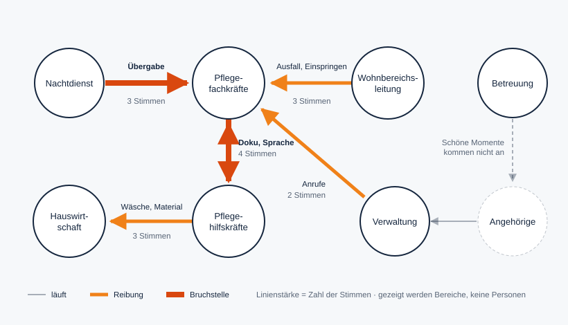

# Fallstudie 2: Haus am Elbufer (Pflege)

**Stand:** 05.11.2026 · **Status:** Entwurf zur Freigabe
**Branche:** Gesundheit und Pflege · **Betrieb:** fiktiv, alle Personen erfunden
**Aufbau wie** [`01_metallbau_heidekamp.md`](01_metallbau_heidekamp.md): Teil A zeigt, was der Betrieb in ROKIO sieht, Teil B ist Hintergrund für uns.

> **Kennzeichnung:** 🟢 belegt (Quelle in B6) · 🔵 ROKI geprüft (geprüfte ROKI-Recherche im Repo) · ⚪ Annahme für den fiktiven Betrieb · 🟠 Szenario mit genannter Annahme

**Was dieser Fall zusätzlich zum Metallbau prüft:**
- Viele Rollen mit unterschiedlicher Qualifikation (Fachkraft, Hilfskraft, Betreuung)
- Drei Schichten mit Übergaben rund um die Uhr
- Sprache als Bruchstelle: viele Kolleginnen und Kollegen mit anderer Muttersprache
- Hochsensible Daten über Bewohnerinnen und Bewohner. Das stärkste Argument für lokale KI.

---

# Teil A: Das Ergebnis, wie ROKIO es zeigt

Anrede: **Sie** (beim Anlegen gewählt).

## A1. Persönliche Rückmeldung

Beispiel: Pflegehilfskraft, seit einem Jahr im Haus

> „Dass Sie in der Übergabe nicht alles verstehen und später nachfragen müssen, ist jetzt festgehalten. **Sie sind nicht allein:** Auch Fachkräfte und Wohnbereichsleitung beschreiben, dass bei der Übergabe Informationen verloren gehen. Es ist das größte Thema im Haus.“

Darunter: „15 von 100 haben teilgenommen“ · „Ergebnisbesprechung am 10. Dezember, 14 Uhr, Speisesaal“ · **Zur aktuellen Analyse**

## A2. Analyse (nur Probleme)

### Erster Blick

**Die Kernzahl**

> **16 Stunden pro Woche** gehen bei den bisher 15 Stimmen an Übergaben, Doppel-Dokumentation, Wegen und Anrufen verloren. **7,4 Stunden davon ist Fachkraftzeit**, also genau die Zeit, die das Haus auf dem Arbeitsmarkt am schwersten findet.

**Die Übergabe-Karte**



**Die drei größten Handlungsfelder**

| Handlungsfeld | Gemeinsame Aufgabe | Stimmen aus | Std./Woche | €/Jahr |
|---|---|---|---|---|
| **Schichtübergabe** | Jede Schicht weiß, was die vorige erlebt hat, in verständlicher Sprache. | Nachtdienst, Fachkräfte, Hilfskräfte, Wohnbereichsleitung | 4,3 | ≈ 8.600 |
| **Pflegedokumentation** | Wer etwas beobachtet, dokumentiert es einmal, direkt und richtig. | Fachkräfte, Hilfskräfte | 4,2 | ≈ 8.700 |
| **Wäsche und Material** | Was gebraucht wird, ist da, ohne dass die Pflege es holen muss. | Hilfskräfte, Hauswirtschaft | 3,4 | ≈ 5.300 |

**Mitsprache:** „Meine Vorschläge kommen an, und es passiert etwas.“ Team: **2,3** von 5 ⚪

### Zweiter Blick

| Handlungsfeld | Was die Stimmen sagen | Systemische Ursache | Std./Woche | bremst (Ø) ⚪ |
|---|---|---|---|---|
| Schichtübergabe | Wichtiges aus der Nacht fehlt, Abkürzungen und Tempo überfordern, die Leitung klärt hinterher nach | Übergabe nur mündlich, zwischen Tür und Angel, ohne Struktur | 4,3 | 4,1 |
| Pflegedokumentation | Fachkräfte dokumentieren für Hilfskräfte mit, oft nach Dienstende. Erst Papier, dann Programm. | Hilfskräfte können nicht selbst dokumentieren, und Beobachtungen werden mündlich weitergereicht | 4,2 | 4,3 |
| Wäsche und Material | Wege in den Keller, die Hauswirtschaft erfährt vom Bedarf zu spät | Kein Bedarfssignal zwischen Wohnbereich und Hauswirtschaft | 3,4 | 3,6 |
| Angehörigenanrufe | Anrufe unterbrechen die Pflege, die Verwaltung kann nichts sagen | Kein Weg, auf dem Angehörige regelmäßig etwas erfahren | 2,1 | 3,2 |
| Ausfall und Einspringen | Morgens wird eine Liste abtelefoniert, Teilzeitkräfte werden im Frei angerufen | Wünsche und Verfügbarkeit stehen nirgends | 1,8 (+ Belastung) | 4,4 |

**Unterschiedliche Sichtweisen beim Einspringen:**
- Die Wohnbereichsleitung sagt: „Keiner will einspringen.“
- Eine Teilzeit-Fachkraft sagt: „Ich würde manche Dienste gern übernehmen, wenn man mich vorher fragt, welche.“

**Unterschiedliche Sichtweisen bei der Hauswirtschaft:**
- Die Pflege sagt: „Die Wäsche ist nie da.“
- Die Hauswirtschaft sagt: „Ich erfahre erst davon, wenn jemand ungeduldig vor mir steht.“

**Genannte Stärken:**
- „Im Nachtdienst halten wir zusammen.“
- „Die Bewohner kennen uns beim Namen.“
- „Die Betreuung macht im Demenzbereich einen tollen Job.“

**Körperliche Belastung:** Zwei Stimmen nennen Transfers ohne zweite Person. Das Thema erscheint als eigenes Handlungsfeld **ohne Zeit- und Euro-Angabe** (bremst Ø 3,9 ⚪). Was den Körper belastet, lässt sich nicht in Minuten fassen und wird trotzdem gezeigt.

Am Ende: **„Was sich ändern kann →“**

## A3. Lösungen

### Erster Blick

Die Übergabe-Karte mit dem Umschalter **heute / mit Lösungen**. An den Linien steht dann:
- Nachtdienst → Fachkräfte: *Übergabe-Assistent*
- Fachkräfte ↔ Hilfskräfte: *Sprechen statt Schreiben*
- Hilfskräfte → Hauswirtschaft: *Transportroboter mit Bedarfsmeldung*
- Wohnbereichsleitung → Fachkräfte: *Einspring-Assistent*
- Verwaltung → Fachkräfte: *Angehörigen-Brücke*

### Zweiter Blick

**Reife:** ● heute im Einsatz · ◐ Bausteine verfügbar, als Gesamtlösung ein Pilot · ○ Forschung

---

#### Schichtübergabe → **Übergabe-Assistent, mehrsprachig**
*Jede Schicht weiß, was die vorige erlebt hat, in der eigenen Sprache.*

**So läuft es**
1. Der Nachtdienst spricht Beobachtungen zu den Bewohnern direkt nach dem Rundgang ein: „Zimmer 12, hat kaum getrunken, war gegen drei unruhig.“
2. Die KI ordnet die Beobachtungen nach Zimmern und Themen (Schlaf, Trinken, Auffälligkeiten, offene Aufgaben). Sie fragt nach, was zu klären ist: „Arzt informieren?“
3. Der Frühdienst liest oder hört die Übergabe in seiner Sprache. Abkürzungen sind ausgeschrieben, und Nachfragen gehen per Sprache: „Was heißt ‚Mob. erschwert‘?“

**Was es braucht:**
- ein Diensthandy pro Wohnbereich,
- eine feste Struktur der Übergabe (die KI schlägt sie vor, das Team passt sie an),
- **eine lokal betriebene KI**, weil es um Gesundheitsdaten geht,
- eine Regel, wer die Übergabe bestätigt.

**Der KI-Kniff:** Die KI übersetzt nicht nur Sprachen. Sie übersetzt **Fachkürzel in Klartext** und **Beiläufiges in Struktur**. Wer neu ist oder eine andere Muttersprache hat, versteht die Übergabe so gut wie alle anderen und muss nicht heimlich nachfragen.

**Wofür die Zeit frei wird:** Die Übergabe wird kürzer, und die Wohnbereichsleitung muss nicht mehr nachklären. Neue Kolleginnen und Kollegen arbeiten früher sicher.

Reife ◐ · nicht von ROKI geprüft · Spracherkennung und Übersetzung sind verfügbar. Die strukturierte Übergabe aus Sprache wäre ein Pilot.
**Erster Testlauf:** ein Wohnbereich, Übergabe Nacht → Früh, vier Wochen, zunächst ohne Namen (nur Zimmernummern).

---

#### Pflegedokumentation → **Sprechen statt Schreiben**
*Wer etwas beobachtet, dokumentiert es selbst. Die Fachkraft prüft, statt mitzuschreiben.*

**So läuft es**
1. Die Hilfskraft spricht nach der Grundpflege ein: „Frau aus Zimmer 7, Haut am Steiß gerötet, hat Frühstück halb gegessen.“
2. Die KI macht daraus einen Entwurf in Fachsprache, ordnet ihn dem richtigen Bewohner und Bereich zu und markiert, was eine Fachkraft bewerten muss.
3. Die Fachkraft prüft und zeichnet mit einem Klick ab. Die Verantwortung bleibt bei ihr.

**Was es braucht:**
- eine digitale Pflegedokumentation (vorhanden),
- Zugänge für Hilfskräfte mit passender Rolle,
- eine klare Regel, was die Fachkraft abzeichnet,
- eine lokal betriebene KI.

**Der KI-Kniff:** Die Beobachtung kommt in den Worten derjenigen an, die sie gemacht hat. Die Hilfskraft bekommt eine eigene Stimme in der Dokumentation, und die Fachkraft muss nichts mehr abschreiben. Das passt zur neuen Aufgabenteilung nach dem Personalbemessungsverfahren, bei der mehr Assistenzkräfte mit Fachkräften zusammenarbeiten 🟢.

**Wofür die Zeit frei wird:** Fachkräfte gewinnen Zeit für Behandlungspflege und Anleitung und gehen pünktlich nach Hause.

Reife ◐ bis ● · nicht von ROKI geprüft · Sprachdokumentation ist am Markt. Zahlen zur Zeitersparnis stammen bisher aus Pilotstudien mit Anbieterbeteiligung 🟢. Unabhängige Belege fehlen.
**Erster Testlauf:** zwei Hilfskräfte und eine Fachkraft, Frühdienst, vier Wochen. Dokumentationszeit vorher und nachher selbst notieren.

---

#### Wäsche und Material → **Transportroboter mit Bedarfsmeldung**
*Handtücher, Wäsche und Material kommen zur Pflege, nicht umgekehrt.*

**So läuft es**
1. Die Pflege meldet Bedarf per Sprache oder Foto des Wagens: „Wohnbereich 2, Handtücher fast leer.“
2. Die KI bündelt die Meldungen, sieht Muster (zum Beispiel montags mehr Bettwäsche) und plant Touren. Die Hauswirtschaft packt vorab.
3. Ein Transportroboter fährt per Aufzug von der Wäscherei zum Wohnbereich.

**Dazu für die körperliche Belastung:** Exoskelette für Transfers, freiwillig und nach Anprobe.

**Was es braucht:**
- Aufzug und Türen, die der Roboter nutzen kann,
- feste Übergabepunkte,
- einen Hygieneplan,
- eine Messung der heutigen Wege vorab.

**Der KI-Kniff:** Nicht der Roboter ist der Trick, sondern das **Bedarfssignal**. Die Hauswirtschaft erfährt vorher, was gebraucht wird. Der Roboter erledigt die Wege, die es dann noch gibt.

**Wofür die Zeit frei wird:** Die Pflege bleibt auf dem Wohnbereich. Die Hauswirtschaft arbeitet planbar statt auf Zuruf.

Reife: Transportroboter ● 🔵 (Pflege-Recherche 2, 3.3: das derzeit klarste Entlastungspotenzial; in beobachteten Kliniken liefen 77,15 % der Transporte von Hand; entscheidend sind Aufzüge, Türen, Übergabepunkte, Hygiene) · Exoskelette ● 🔵 (Pflege-Recherche 3.6: als entlastend beschrieben, Nutzen hängt von Person und Tätigkeit ab)
**Erster Testlauf:** zwei Wochen lang Wege messen, dann eine Route (Wäscherei → Wohnbereich 2).
**Bewusst nicht vorgeschlagen:** multifunktionale Assistenzroboter wie Lio. Im 22-monatigen Feldtest gab es keine wahrnehmbare Entlastung, und die Akzeptanz beim Personal sank 🔵 (Pflege-Recherche 3.4).

---

#### Ausfall und Einspringen → **Einspring-Assistent**
*Niemand telefoniert morgens eine Liste ab. Wer gern einspringt, wird zuerst gefragt.*

**So läuft es**
1. Alle hinterlegen einmal ihre Wünsche: „Spätdienste am Wochenende gern, Frühdienst nie, höchstens zweimal im Monat.“
2. Meldet sich jemand krank, schlägt die KI passende Personen vor. Sie berücksichtigt Wünsche, Ruhezeiten und die nötige Qualifikation und schickt die Anfrage nacheinander per Nachricht. Wer zuerst zusagt, übernimmt den Dienst.
3. Für den Monatsplan erstellt die KI einen Entwurf aus allen Wünschen. Die Pflegedienstleitung prüft und gibt frei.

**Was es braucht:**
- eine digitale Dienstplanung,
- Diensthandys oder Zustimmung zur Nutzung privater Handys,
- Regeln für Ruhezeiten und Qualifikationsmix,
- die Zustimmung des Teams zu den Spielregeln.

**Der KI-Kniff:** Die Wünsche der Beschäftigten werden Teil der Planung, nicht ihr Störfaktor. Die KI wägt ab, was ein Mensch morgens um sechs nicht im Kopf haben kann.

**Wofür die Zeit frei wird:** Die Wohnbereichsleitung beginnt ihren Dienst mit der Pflege statt am Telefon. Freie Tage bleiben frei.

Reife ◐ · nicht von ROKI geprüft · Dienstplan-Software ist im Einsatz, KI-gestützte Vorschläge aus Wünschen wären ein Pilot.
**Erster Testlauf:** Wünsche einsammeln (eine Woche), dann vier Wochen Einspringen per Nachricht in einem Wohnbereich.

---

#### Angehörigenanrufe → **Angehörigen-Brücke**
*Angehörige erfahren regelmäßig, wie es geht, und müssen nicht anrufen.*

**So läuft es**
1. Einmal pro Woche schreibt die KI aus Dokumentation und Betreuungsnotizen einen kurzen, persönlichen Bericht pro Bewohner. Die Bezugspflegekraft gibt ihn frei.
2. Die Betreuung ergänzt besondere Momente: „Hat heute beim Singen mitgemacht.“ Mit Einwilligung kommt ein Foto dazu.
3. Ruft jemand an, beantwortet ein Telefonassistent Routinefragen (Besuchszeiten, Wäsche) und vereinbart für Persönliches einen Rückrufzeitpunkt mit der Bezugspflegekraft.

**Was es braucht:**
- Einwilligungen von Bewohnern bzw. Betreuern,
- eine Freigaberegel,
- feste Rückrufzeiten,
- eine lokal betriebene KI für Gesundheitsangaben.

**Der KI-Kniff:** Aus nüchterner Dokumentation wird ein warmer, verständlicher Bericht. Was die Betreuung leistet, wird endlich sichtbar.

**Wofür die Zeit frei wird:** Die Pflege wird seltener unterbrochen. Die Betreuung bekommt Anerkennung, die bisher fehlte.

Reife ◐ · nicht von ROKI geprüft
**Erster Testlauf:** zehn Familien, vier Wochen, Anrufe vorher und nachher zählen.

---

### Bauplan-Prompt (Beispiel: Übergabe-Assistent)

```text
Du bist der Übergabe-Assistent im Haus am Elbufer, einer vollstationären
Pflegeeinrichtung (100 Beschäftigte, Wohnbereich für Menschen mit Demenz,
Dreischichtbetrieb). Du läufst auf einem lokalen Modell; Namen von
Bewohnern verarbeitest du nicht, nur Zimmernummern.

EINGABE
Sprachnotizen des Nachtdienstes, abgeschrieben, z. B.
„Zimmer 12, kaum getrunken, gegen drei unruhig“.

AUSGABE: Übergabe für den Frühdienst
- Je Zimmer: Schlaf · Trinken/Essen · Auffälligkeiten · Offene Aufgaben.
- Ganz oben: „Heute zuerst“ – höchstens 3 Punkte, die nicht warten können.
- Wenn etwas ärztlich abgeklärt werden müsste, schreib
  „Prüfen: Arzt informieren?“ – entscheide es nie selbst.
- Keine Diagnosen, keine Medikamentenempfehlungen.

SPRACHE
- Klare, kurze Sätze, keine Abkürzungen. Kürzel aus der Notiz schreibst du aus.
- Auf Wunsch übersetzt du die ganze Übergabe in die Sprache der Person
  (z. B. Bosnisch, Ukrainisch, Tagalog) und behältst Fachbegriffe in
  Klammern auf Deutsch bei.
- Fragen zur Übergabe beantwortest du nur aus der Übergabe.
  Steht es nicht drin: „Bitte beim Nachtdienst oder der
  Wohnbereichsleitung nachfragen.“
```

### Vision: ein Dienstag in einem Jahr

| Bereich | Heute | In einem Jahr |
|---|---|---|
| Nachtdienst | erzählt die Nacht um 6 Uhr zwischen Tür und Angel | hat beim letzten Rundgang eingesprochen, die Übergabe liegt strukturiert vor |
| Hilfskräfte | verstehen die Übergabe halb und geben Beobachtungen mündlich weiter | lesen die Übergabe in ihrer Sprache und dokumentieren selbst per Sprache |
| Fachkräfte | schreiben nach Dienstende für andere mit | prüfen und zeichnen ab, Feierabend pünktlich |
| Hauswirtschaft | erfährt vom Bedarf, wenn jemand vor ihr steht | packt vorab, der Roboter fährt |
| Wohnbereichsleitung | telefoniert morgens die Liste ab | bekommt die Zusage per Nachricht |
| Angehörige | rufen an und erreichen niemanden | lesen jeden Freitag, wie die Woche war |

**Zeit und Geld** 🟠 (Annahmen per Regler änderbar)

| Handlungsfeld | heute Std./W. | Annahme | zurück Std./W. | zurück €/Jahr |
|---|---|---|---|---|
| Schichtübergabe | 4,3 | −50 % | 2,2 | ≈ 4.300 |
| Pflegedokumentation | 4,2 | −50 % | 2,1 | ≈ 4.400 |
| Wäsche und Material | 3,4 | −60 % | 2,0 | ≈ 3.200 |
| Angehörigenanrufe | 2,1 | −50 % | 1,0 | ≈ 2.000 |
| Ausfall und Einspringen | 1,8 | −60 % | 1,1 | ≈ 2.400 |
| **Summe (15 Stimmen)** | **15,9** | | **8,5** | **≈ 16.300** |

Die Zahlen beruhen nur auf 15 Stimmen in einem Haus mit 100 Beschäftigten. In ROKIO wächst die Rechnung mit jeder Stimme. Hochgerechnet wird nicht.

**Arbeitsfreude:** In der Altenpflege sind die Fehlzeiten überdurchschnittlich hoch 🟢. Jede Stunde, in der eine Fachkraft pflegt statt abzuschreiben, und jeder freie Tag, der frei bleibt, zahlt auf das ein, was in der Pflege am knappsten ist: Menschen, die bleiben.

### Fahrplan

| Wann | Was | Woran man es merkt |
|---|---|---|
| **2 Wochen** | Übergabe-Struktur festlegen · Wege messen · Einspring-Wünsche einsammeln · Anrufe zählen | erste Zahlen |
| **3 Monate** | Pilot Übergabe-Assistent (lokal) · Sprechen statt Schreiben im Frühdienst · Einspring-Assistent in einem Wohnbereich · Exoskelett-Erprobung | kurze ROKIO-Nachbefragung |
| **12 Monate** | Entscheidung Transportroboter · Angehörigen-Brücke · alle Wohnbereiche | zweite ROKIO-Runde |

---

# Teil B: Hintergrund (intern)

## B1. Eingaben beim Anlegen

| Feld | Eingabe |
|---|---|
| Name, Ort | Haus am Elbufer, Bleckede, Landkreis Lüneburg |
| Branche, Größe | Gesundheit und Pflege, 100 Beschäftigte, vollstationär, mit Wohnbereich für Menschen mit Demenz |
| Website | `haus-am-elbufer.de` (fiktiv): „Leben am Fluss, gut begleitet. 96 Plätze in drei Wohnbereichen, eigener Bereich für Menschen mit Demenz, eigene Küche und Wäscherei. Wir bilden aus.“ |
| Ziel (ein Satz) | „Wir verlieren Fachkräfte an die Klinik. Ich will wissen, was den Alltag bei uns schwer macht.“ |
| Deadline | Mi., 10.12.2026, 14 Uhr, Ergebnisbesprechung im Speisesaal |
| Anrede | Sie |

| Bereich | Personen | Spanne €/Std. ⚪ | Mitte |
|---|---|---|---|
| Leitung (Einrichtungs- und Pflegedienstleitung) | 3 | 55–70 | 62 |
| Wohnbereichsleitungen | 3 | 45–52 | 48 |
| Pflegefachkräfte (inkl. Nachtdienst) | 34 | 42–50 | 46 |
| Pflegehilfs- und Assistenzkräfte | 30 | 32–38 | 35 |
| Betreuung | 8 | 30–36 | 33 |
| Hauswirtschaft und Wäscherei | 10 | 28–34 | 31 |
| Küche | 7 | 30–36 | 33 |
| Verwaltung und Haustechnik | 5 | 34–40 | 37 |

**Aus der Website abgeleitete Aufgaben-Chips (Auswahl):**
- Pflegefachkräfte: Übergabe · Dokumentation · Behandlungspflege · Anleitung · Arztkontakt
- Hilfskräfte: Grundpflege · Wäsche und Material holen · Beobachtungen weitergeben · Essen anreichen
- Hauswirtschaft: Wäsche verteilen · Bedarf erkennen
- Wohnbereichsleitung: Dienstplan · Ausfälle · Angehörige

**Branchenkatalog Pflege** (für Rückfragen, nicht als Vorgabe): Übergabe · Dokumentation · Wege und Transporte · Dienstplan und Ausfälle · Angehörige · körperliche Belastung · Sprache und Einarbeitung · Zusammenarbeit mit Ärzten und Apotheke.

## B2. Die Menschen

| Person | Rolle | Was die Leitung nicht hört |
|---|---|---|
| Ines, 54 | Einrichtungsleiterin | (Leitung) Sie sieht Personalmangel als Hauptproblem. |
| Jana, 39 | Wohnbereichsleitung | Sie verbringt die erste halbe Stunde jedes zweiten Tags am Telefon. |
| Tobias, 31 | Fachkraft, Frühdienst | Er dokumentiert nach Dienstende für Hilfskräfte mit und gilt als „langsam“. |
| Malika, 45 | Fachkraft, Nachtdienst | Sie fühlt sich bei der Übergabe gehetzt: „Was ich nachts erlebe, interessiert morgens keinen.“ |
| Ivana, 27 | Pflegehilfskraft, seit einem Jahr im Haus, Anerkennung als Fachkraft läuft | Sie versteht die Übergabe nicht ganz und fragt heimlich nach. Ihre Beobachtungen gehen über andere in die Dokumentation und kommen manchmal nicht an. |
| Birgit, 42 | Fachkraft, Teilzeit | Sie würde gern einspringen, aber planbar. Stattdessen wird sie im Frei angerufen. |
| Dorothea, 58 | Hauswirtschaft | Sie wird als Engpass gesehen, erfährt aber vom Bedarf zu spät. |
| Leon, 24 | Betreuung | Seine schönen Momente mit Bewohnern erreichen die Angehörigen nie. |
| Sabine, 50 | Verwaltung | Sie stellt Anrufe durch, die die Pflege unterbrechen. |

**Die Sicht der Leitung:** Ines sucht Fachkräfte. Die Stimmen zeigen, dass vorhandene Fachkräfte Stunden mit Mitschreiben, Nachklären und Telefonieren verbringen. Und dass die Assistenzkräfte, auf die das Haus künftig stärker setzt, an der Sprache und an fehlenden Zugängen hängen.

## B3. Rohdaten: 15 Stimmen

Jede Person zählt nur ihre eigene Zeit. Rechnung wie in `lib/rechnen.ts`.

| ID | Bereich | Aussage | Häufigkeit | Min. | Std./W. | €/J. | Feld |
|---|---|---|---|---|---|---|---|
| Ü1 | Fachkräfte | „Bei der Übergabe fehlt oft, wer schlecht geschlafen oder nichts getrunken hat. Ich frage mich durch.“ | täglich | 15 | 1,25 | 2.645 | Übergabe |
| Ü2 | Fachkräfte (Nacht) | „Morgens erzähle ich alles in zehn Minuten zwischen Tür und Angel. Die Hälfte kommt nicht an.“ | täglich | 10 | 0,83 | 1.763 | Übergabe |
| Ü3 | Hilfskräfte | „In der Übergabe sprechen alle schnell und mit Abkürzungen. Ich frage später heimlich nach.“ | täglich | 15 | 1,25 | 2.012 | Übergabe |
| Ü4 | Wohnbereichsleitung | „Ich kläre hinterher, was untergegangen ist, zum Beispiel ob der Arzt informiert wurde.“ | mehrmals/W. | 20 | 1,00 | 2.208 | Übergabe |
| D1 | Fachkräfte | „Ich dokumentiere für die Hilfskräfte mit, oft nach Dienstende.“ | täglich | 25 | 2,08 | 4.408 | Doku |
| D2 | Fachkräfte | „Wir schreiben auf Papier und tippen es später ins Programm.“ | täglich | 20 | 1,67 | 3.527 | Doku |
| D3 | Hilfskräfte | „Ich sage der Fachkraft, was ich gesehen habe. Manchmal geht es unter.“ | mehrmals/W. | 10 | 0,50 | 805 | Doku |
| W1 | Hilfskräfte | „Ich laufe für Handtücher und Material in den Keller, weil der Wagen leer ist.“ | mehrmals tägl. | 8 | 1,33 | 2.147 | Material |
| W2 | Hauswirtschaft | „Die Pflege meldet nicht, was fehlt. Ich sehe es erst, wenn jemand vor mir steht.“ | täglich | 15 | 1,25 | 1.782 | Material |
| W3 | Hilfskräfte | „Ich suche Rollstühle und Lifter, bevor ich mobilisieren kann.“ | täglich | 10 | 0,83 | 1.342 | Material |
| E1 | Wohnbereichsleitung | „Wenn morgens jemand krank ist, telefoniere ich die Liste ab.“ | mehrmals/W. | 30 | 1,50 | 3.312 | Einspringen |
| E2 | Fachkräfte | „Ich werde im Frei angerufen. Ich würde manche Dienste gern übernehmen, wenn man mich vorher fragt.“ | wöchentlich | 10 | 0,17 | 353 | Einspringen |
| E3 | Fachkräfte | „Ich rufe zurück, verhandle, sage dann doch zu.“ | wöchentlich | 10 | 0,17 | 353 | Einspringen |
| A1 | Verwaltung | „Angehörige wollen wissen, wie es geht. Ich weiß es nicht und stelle durch.“ | mehrmals tägl. | 5 | 0,83 | 1.418 | Angehörige |
| A2 | Fachkräfte | „Mitten in der Pflege klingelt das Telefon, ein Angehöriger fragt nach Kleinigkeiten.“ | täglich | 15 | 1,25 | 2.645 | Angehörige |
| | | | | | **15,92** | **30.720** | |

**Belastung ohne Zeitangabe:** zwei Stimmen aus Hilfs- und Fachkräften zu Transfers ohne zweite Person. **Routinezeit, verlagerbar:** Die Pflegedienstleitung plant zwei volle Tage pro Monat Dienstplan.

## B4. Was der Fall für ROKIO zeigt (zusätzlich zum Metallbau)

1. **Sprache als eigenes Thema:** Die Befragung muss auch in einfacher Sprache und per Sprachaufnahme in anderen Sprachen funktionieren. Die KI übersetzt die Antwort intern. Sonst fehlen genau die Stimmen, um die es geht.
2. **Gesundheitsdaten:** Antworten können Bewohnerdaten enthalten. Die KI entfernt sie vor dem Speichern (wie heute bei Namen). Im Pitch: Pflege ist der Fall, in dem lokale KI nicht optional ist.
3. **Qualifikationsstufen statt Bereiche:** Fachkraft und Hilfskraft arbeiten im selben Wohnbereich. Die Übergabe-Karte zeigt deshalb Rollen, nicht Stationen.
4. **Wünsche als Lösungsbaustein:** Der Einspring-Assistent macht eine Bottom-up-Angabe (Wünsche) direkt zum Teil der Lösung.
5. **Körperliche Belastung** hat oft keine Zeitangabe. Sie muss im Profil sichtbar sein, ohne in Euro gerechnet zu werden.

## B5. Prüfkriterien für die KI-Ausgabe

- [ ] Übergabe und Dokumentation als bereichsübergreifend erkennen (Fach- und Hilfskräfte)
- [ ] die beiden Sichtweisen beim Einspringen und bei der Hauswirtschaft benennen
- [ ] keine Bewohnernamen, keine Diagnosen in Zusammenfassungen
- [ ] „ROKI geprüft“ nur für Transportroboter (3.3) und Exoskelette (3.6); Lio (3.4) nur als Warnung
- [ ] keine Anbieter oder Produkte
- [ ] Sprache der Lösungen: konkret für dieses Haus (Wohnbereich, Wäscherei, Nachtdienst)

## B6. Quellen und Prüfstatus

| # | Aussage | Quelle | Status |
|---|---|---|---|
| Q1 | Pflege- und Gesundheitsberufe 2025 mit den stärksten Engpässen; in der Pflege +46.000 Beschäftigte mit ausländischer, −5.000 mit deutscher Staatsangehörigkeit (Juni 2025 zu Juni 2024) | [BA-Presseinfo 32/2026, Fachkräfteengpassanalyse 2025](https://www.arbeitsagentur.de/presse/2026-32-fachkraefte-bleiben-knapp-zuwanderung-gewinnt-weiter-an-bedeutung) | 🟢 gelesen |
| Q2 | Überdurchschnittlich hohe Fehlzeiten bei Altenpflegekräften; jeder fünfte AU-Tag durch Muskel-Skelett- oder Atemwegserkrankungen (2023) | [Ärzteblatt zur BKK-Auswertung, 05.05.2025](https://www.aerzteblatt.de/news/gesundheitsberufe-krankenstand-auch-bei-jungeren-hoch-1fa90d7a-568f-454d-bd92-9fc4e42d9354) | 🟢 gelesen |
| Q3 | Neuer Qualifikationsmix nach § 113c SGB XI bringt neue Aufgabenteilung zwischen Fach- und Assistenzkräften | [Caritas: Das Personalmodell ändert sich grundlegend](https://www.caritas.de/neue-caritas/heftarchiv/jahrgang2023/artikel/das-personalmodell-aendert-sich-grundlegend) | 🟢 laut Suchzusammenfassung |
| Q4 | Zahlen zur Zeitersparnis bei Sprachdokumentation stammen aus Pilotstudien mit Anbieterbeteiligung; unabhängige Studien in der Langzeitpflege fehlen | [medi-karriere: KI in der Pflegedokumentation](https://www.medi-karriere.de/magazin/ki-in-der-pflegedokumentation/) | 🟢 laut Suchzusammenfassung |
| Q5 | Anteil der Arbeitszeit für Dokumentation: Angaben zwischen 13 % und 40 %, je nach Quelle und Methode | u. a. [Caritas: Entbürokratisierung der Pflege](https://caritas.de/beitraege/entbuerokratisierung-der-pflege/978048) | ⚠️ widersprüchlich, im Dokument bewusst nicht verwendet |
| Q6 | Gallup: 10 % hoch gebunden, 41 % weniger Fehlzeit | siehe Fallstudie 1, Q2 | 🟢 |
| R1 | Transportroboter: klarstes Entlastungspotenzial; 77,15 % der beobachteten Transporte von Hand; Aufzüge, Türen, Übergabepunkte, Hygiene entscheidend | `ROKI_Recherche_Roboter_in_der_Pflege_2026-08-18_geprueft.md` 2, 3.3 | 🔵 |
| R2 | Exoskelette in der Pflege | dieselbe Datei, 3.6 | 🔵 |
| R3 | Lio: keine wahrnehmbare Entlastung, Akzeptanz beim Personal sank | dieselbe Datei, 3.4 | 🔵 |

**Annahmen ⚪:** Betrieb, Personen, Stimmen, Häufigkeiten, Profilwerte, Stundensatz-Spannen, Prozentwerte im Szenario.
