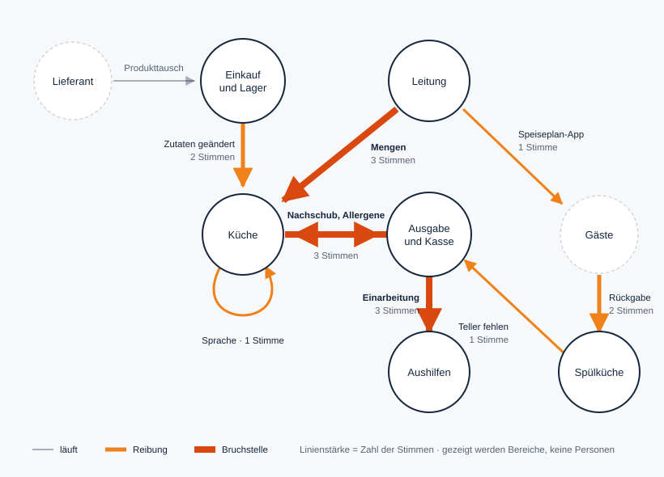

# Fallstudie 3: Mensa am Kanal (Gemeinschaftsverpflegung)

**Stand:** 05.11.2026 · **Status:** Entwurf zur Freigabe
**Branche:** Gastronomie · **Betrieb:** fiktiv, alle Personen erfunden
**Aufbau wie** [`01_metallbau_heidekamp.md`](01_metallbau_heidekamp.md): Teil A zeigt, was der Betrieb in ROKIO sieht, Teil B ist Hintergrund für uns.

> **Kennzeichnung:** 🟢 belegt (Quelle in B6) · 🔵 ROKI geprüft (geprüfte ROKI-Recherche im Repo) · ⚪ Annahme für den fiktiven Betrieb · 🟠 Szenario mit genannter Annahme

**Was dieser Fall zusätzlich prüft:**
- Eine Stoßzeit von zwei Stunden, in der alle Übergaben gleichzeitig laufen
- Viele wechselnde Aushilfen und ein mehrsprachiges Team
- Gäste als Teil des Ablaufs (Tablettrückgabe, Fragen nach Allergenen)
- Ein Problem, das nicht nur Zeit kostet, sondern **Ware**. ROKIO rechnet bisher nur Zeit.
- **Für den Pitch:** Jede Person in der Jury kennt eine Mensa von innen, zumindest von der Gästeseite.

---

# Teil A: Das Ergebnis, wie ROKIO es zeigt

Anrede: **du** (beim Anlegen gewählt).

## A1. Persönliche Rückmeldung

Beispiel: Spülkraft

> „Dass zwischen zwölf und zwei das Band überläuft und du hinterher kaum noch kannst, ist jetzt festgehalten. **Du bist nicht allein:** Auch die Ausgabe merkt es, wenn ihr die Teller ausgehen. Deine Stimme ist die erste aus der Spülküche. Genau die hat bisher gefehlt.“

Darunter: „14 von 42 haben teilgenommen“ · „Ergebnisbesprechung am 26. November, 15 Uhr, nach dem Mittag“ · **Zur aktuellen Analyse**

## A2. Analyse (nur Probleme)

### Erster Blick

**Die Kernzahl**

> **14 Stunden pro Woche** gehen bei den bisher 14 Stimmen verloren: beim Nachkochen, Wegkippen, Nachfragen und Sortieren. Dazu kommt Ware, die im Abfall landet. Diese Ware zählt ROKIO bisher nicht.

**Die Übergabe-Karte**



**Die drei größten Handlungsfelder**

| Handlungsfeld | Gemeinsame Aufgabe | Stimmen aus | Std./Woche | €/Jahr |
|---|---|---|---|---|
| **Spülküche in der Stoßzeit** | Geschirr läuft auch zwischen 12 und 14 Uhr ohne Rückstau. | Spülküche, Ausgabe | 4,7 | ≈ 6.100 |
| **Mengenplanung** | Gekocht wird, was gegessen wird, nicht mehr und nicht weniger. | Leitung, Küche, Ausgabe | 3,5 | ≈ 5.500 |
| **Einarbeitung und Sprache** | Jede Aushilfe weiß am ersten Tag, was heute anders ist, in ihrer Sprache. | Ausgabe, Aushilfen, Küche | 3,5 | ≈ 4.800 |

**Mitsprache:** „Meine Vorschläge kommen an, und es passiert etwas.“ Team: **1,9** von 5 ⚪

### Zweiter Blick

| Handlungsfeld | Was die Stimmen sagen | Systemische Ursache | Std./W. | bremst (Ø) ⚪ |
|---|---|---|---|---|
| Spülküche in der Stoßzeit | Das Band läuft über, Tabletts kommen unsortiert zurück, der Ausgabe gehen die Teller aus. | Rückgabe ohne Ordnung, keine Rückmeldung zwischen Spülküche und Ausgabe | 4,7 | 4,5 |
| Mengenplanung | Gekocht wird nach einem Plan von vor vier Wochen. Um 13:15 Uhr ist das Gericht aus, am Abend wird weggekippt. | Kassendaten, Semesterkalender und Wetter fließen nicht in die Planung ein | 3,5 | 4,0 |
| Einarbeitung und Sprache | Jeden Tag wird dasselbe erklärt, die Aushilfen wissen wenig, die Rezepte gibt es nur auf Deutsch. | Jedes Semester neue Aushilfen, Wissen nur mündlich | 3,5 | 3,4 |
| Speiseplan, Rezepturen und Allergene | Ein getauschtes Produkt fällt nicht auf, die Ausgabe weiß nicht, ob Sesam drin ist, die App zeigt das falsche Gericht. | Änderungen an Ware und Plan erreichen Küche, Ausgabe und App nicht | 2,3 | 3,8 |

**Unterschiedliche Sichtweisen:**
- Bei den Mengen sagt die Leitung: „Die Küche kocht zu viel.“ Die Küche sagt: „Wir kochen genau den Plan. Der Plan weiß nur nichts von Prüfungswochen und Regen.“
- Bei den Allergenen sagt der Einkauf: „Wem sage ich, dass der Lieferant getauscht hat?“ Die Ausgabe sagt: „Ich muss es den Gästen beantworten, und keiner sagt es mir.“

**Genannte Stärken:**
- „Die Stammgäste kennen uns und loben das Essen.“
- „Das Kernteam in der Küche ist eingespielt.“
- „Die Aushilfen sind motiviert, wenn man sie lässt.“

**Was ROKIO hier nicht zählt:** Ware im Abfall. In der Außer-Haus-Verpflegung landen rund 1,9 Mio. Tonnen Lebensmittel pro Jahr im Abfall 🟢, in der Mensa ist das der größte Kostenblock des Problems. ROKIO zeigt das als Hinweis, bis es eine eigene Erfassung gibt (siehe B4).

Am Ende: **„Was sich ändern kann →“**

## A3. Lösungen

### Erster Blick

Die Übergabe-Karte mit dem Umschalter **heute / mit Lösungen**. An den Linien steht dann:
- Leitung → Küche: *Mengen-Prognose*
- Küche ↔ Ausgabe: *Nachkoch-Signal* und *Rezeptur-Wächter*
- Gäste → Spülküche: *Rückgabe mit Augen*
- Ausgabe → Aushilfen: *Schicht-Briefing in jeder Sprache*

### Zweiter Blick

**Reife:** ● heute im Einsatz · ◐ Bausteine verfügbar, als Gesamtlösung ein Pilot · ○ Forschung

---

#### Mengenplanung → **Mengen-Prognose mit Nachkoch-Signal**
*Gekocht wird, was gegessen wird.*

**So läuft es**
1. Am Vortag schätzt die KI für jedes Gericht die Portionen. Sie nutzt dafür die Kassendaten der letzten Semester, den Semesterkalender (Prüfungswochen, vorlesungsfreie Zeit), das Wetter und Veranstaltungen auf dem Campus.
2. Gekocht wird in Wellen: zuerst 70 % der Prognose, den Rest nach Bedarf.
3. Während der Ausgabe verfolgt die KI die Verkäufe an der Kasse und meldet der Küche: „Curry geht schneller als gedacht. 40 Portionen nachkochen, fertig bis 12:45.“

**Was es braucht:**
- Kassendaten als Export (sind vorhanden),
- den Semesterkalender,
- einen Bildschirm in der Küche,
- Rezepte, die sich in Wellen kochen lassen,
- eine Absprache, ab wann nachgekocht wird.

**Der KI-Kniff:** Die KI verbindet Signale, die heute niemand gleichzeitig im Blick hat. Ein Projekt an der Mensa der Uni Bayreuth hat so den Prognosefehler beim Kaffee fast halbiert, die Ausweitung auf Speisen war geplant 🟢. Dazu lernt sie aus den Tellerresten der „Rückgabe mit Augen“ (unten), welche Gerichte zu groß portioniert sind.

**Wofür die Zeit frei wird:** weniger hektisches Nachkochen und weniger Wegkippen. Die Ausgabe muss seltener „ist aus“ sagen.

Reife ● bis ◐ · nicht von ROKI geprüft · Laut Verbraucherzentrale können Küchen und Kantinen ihre Abfälle häufig um 30 bis 50 % senken 🟢.
**Erster Testlauf:** vier Wochen lang Prognose neben dem bisherigen Plan laufen lassen und vergleichen, ohne danach zu kochen.

---

#### Spülküche in der Stoßzeit → **Rückgabe mit Augen**
*Geschirr kommt geordnet zurück. Die Ausgabe weiß, was nachkommt.*

**So läuft es**
1. Über dem Rückgabeband zeigt ein Bildschirm den Gästen in drei Symbolen, wie sie das Tablett abstellen. Eine Kamera erkennt, ob es klappt, und passt die Hinweise an.
2. Dieselbe Kamera erkennt Tellerreste je Gericht, ohne Personen zu erfassen, und meldet sie an die Mengen-Prognose.
3. Das Band zählt Geschirr. Die Ausgabe sieht: „Tiefe Teller: 80 kommen in 6 Minuten.“

**Dazu:**
- Serviceroboter, die im Speisesaal Tablettwagen einsammeln
- Ein Reinigungsroboter für den Speisesaal nach dem Mittag

**Was es braucht:**
- ein Rückgabeband mit Platz für Kamera und Bildschirm,
- eine Datenschutzlösung (nur Tabletts im Bild),
- breite, ebene Wege im Speisesaal für Roboter,
- ein Reinigungsplan für den Rest.

**Der KI-Kniff:** Die Spülküche wird vom Ende der Kette zum **Sensor des ganzen Betriebs**. Was zurückkommt, sagt Küche und Planung, was zu viel war.

**Wofür die Zeit frei wird:** Die Spülkraft spült statt zu sortieren. Die Ausgabe hat Teller, und die Küche weiß, was übrig bleibt.

Reife:
- Rückgabe mit Kamera und Restemessung ◐, nicht von ROKI geprüft.
- Serviceroboter für Transport und Abräumen ● 🔵 (Robotertypen 3.8: typische Aufgaben sind Speisen- und Getränketransport sowie Abräumen; Voraussetzung sind breite, ebene Wege; der Nutzen hängt stark vom Ablauf ab).
- Reinigungsroboter ● 🔵 (Robotertypen 3.7: gut bei größeren, regelmäßig zu reinigenden Flächen).

**Erster Testlauf:** zwei Wochen lang mit Plakat und Symbolen an der Rückgabe arbeiten und den Rückstau zählen. Danach eine Kamera nur zur Restemessung.

---

#### Einarbeitung und Sprache → **Schicht-Briefing in jeder Sprache**
*Jede Aushilfe weiß vor Schichtbeginn, was heute zählt.*

**So läuft es**
1. Jeden Morgen erzeugt die KI aus Speiseplan, Rezepturen und Fotos der Musterteller ein Briefing von drei Minuten: heutige Gerichte, Allergene, Portionsgrößen, Besonderheiten („Dressing heute mit Senf“).
2. Jede Person bekommt es auf das eigene Handy, in der eigenen Sprache, mit Fotos.
3. Neue Aushilfen bekommen am ersten Tag zusätzlich den Rundgang: „Wo ist was?“ als kurze Bildfolge.

**Was es braucht:**
- Speiseplan und Rezepturen in digitaler Form,
- Fotos der Musterteller (einmal pro Gericht),
- eine Gruppe oder App für die Schicht.

**Der KI-Kniff:** Das Briefing schreibt sich jeden Tag selbst, aus Daten, die es ohnehin gibt. Die Sprache ist kein Hindernis mehr, und die Ausgabeleitung erklärt nicht mehr jeden Tag dasselbe.

**Wofür die Zeit frei wird:** Die Ausgabeleitung führt die Schicht, statt einzuarbeiten. Aushilfen fühlen sich am ersten Tag sicher.

Reife ◐ · nicht von ROKI geprüft
**Erster Testlauf:** zwei Wochen, ein Briefing pro Tag, Fragen an der Ausgabe zählen.

---

#### Speiseplan, Rezepturen und Allergene → **Rezeptur-Wächter**
*Ändert sich eine Zutat, wissen es Küche, Ausgabe und Gäste sofort.*

**So läuft es**
1. Beim Wareneingang fotografiert der Einkauf das Etikett eines Ersatzprodukts.
2. Die KI liest die Zutatenliste und vergleicht sie mit der hinterlegten Rezeptur: „Neues Pesto enthält Cashew. Betroffen sind Nudeln Genovese (Di) und Bowl (Do).“ Die Küche bestätigt.
3. Aushang, Bildschirm und Speiseplan-App werden aktualisiert, die Ausgabe bekommt einen Hinweis. Gäste können per QR-Code in jeder Sprache fragen: „Ist im Curry Sellerie?“ Antworten kommen nur aus den bestätigten Rezepturen.

**Was es braucht:**
- Rezepturen mit Zutaten digital,
- ein Handy am Wareneingang,
- eine Person in der Küche, die bestätigt.

**Der KI-Kniff:** Die KI **liest Etiketten** und versteht Zutatenlisten. Damit wird aus einer Pflicht, die heute an Zettelwirtschaft hängt, ein Ablauf, der von selbst Alarm schlägt. Bei loser Ware müssen Kantinen über die 14 Hauptallergene informieren 🟢.

**Wofür die Zeit frei wird:** Die Ausgabe muss nicht mehr in die Küche laufen, und die Küche wird in der Ausgabe nicht mehr unterbrochen.

Reife ◐ · nicht von ROKI geprüft · Die Verantwortung für die Kennzeichnung bleibt beim Betrieb. Die KI schlägt vor, ein Mensch bestätigt.
**Erster Testlauf:** vier Wochen lang jedes Ersatzprodukt fotografieren und die Treffer prüfen.

---

### Bauplan-Prompt (Beispiel: Rezeptur-Wächter)

```text
Du bist der Rezeptur-Wächter der Mensa am Kanal (Hochschulgastronomie,
ca. 1.900 Essen am Tag, Speiseplan wöchentlich, viele internationale Gäste).

DU BEKOMMST
1. Ein Foto eines Produktetiketts (Ersatzprodukt beim Wareneingang).
2. Die hinterlegten Rezepturen der Woche als Tabelle:
   Gericht | Tag | Zutat | Allergene laut bisheriger Zutat.

DEINE AUFGABE
- Lies die Zutatenliste vom Etikett. Kannst du etwas nicht sicher lesen,
  schreib „unleserlich – bitte von Hand prüfen“. Rate nie.
- Ermittle die enthaltenen Hauptallergene (die 14 nach LMIV, z. B. Gluten,
  Sellerie, Senf, Sesam, Schalenfrüchte, Milch, Ei, Soja).
- Vergleiche mit der Zutat, die ersetzt wird. Melde nur Unterschiede.

AUSGABE
„Neu: <Allergene> · Entfällt: <Allergene> · Betroffen: <Gerichte mit Tag>“
Darunter: „Bitte bestätigen, bevor Aushang und App geändert werden.“

FÜR GÄSTEFRAGEN (zweiter Modus)
- Antworte in der Sprache der Frage, kurz.
- Nur aus bestätigten Rezepturen. Unsicher? „Bitte an der Ausgabe nachfragen.“
- Keine Gesundheitsberatung.
```

### Vision: ein Mittwoch im nächsten Semester

| Bereich | Heute | Im nächsten Semester |
|---|---|---|
| Küche | kocht den Plan von vor vier Wochen und kippt am Abend weg | kocht in Wellen nach Prognose, das Nachkoch-Signal kommt von der Kasse |
| Ausgabe | „Ist aus.“ – „Ist da Sesam drin?“ – „Ich frag mal.“ | Gäste fragen den QR-Assistenten, die Ausgabe kennt das Briefing |
| Spülküche | Das Band läuft über, Sortieren von Hand | Tabletts kommen geordnet zurück, die Kamera misst die Reste |
| Aushilfen | lernen am ersten Tag im Stehen | haben vor der Schicht drei Minuten Briefing in ihrer Sprache |
| Einkauf | Ein Produkttausch fällt keinem auf | Ein Foto vom Etikett genügt |

**Zeit und Geld** 🟠 (Annahmen per Regler änderbar)

| Handlungsfeld | heute Std./W. | Annahme | zurück Std./W. | zurück €/Jahr |
|---|---|---|---|---|
| Spülküche in der Stoßzeit | 4,7 | −50 % | 2,3 | ≈ 3.000 |
| Mengenplanung | 3,5 | −60 % | 2,1 | ≈ 3.300 |
| Einarbeitung und Sprache | 3,5 | −50 % | 1,8 | ≈ 2.400 |
| Speiseplan und Allergene | 2,3 | −60 % | 1,4 | ≈ 2.600 |
| **Summe (14 Stimmen)** | **14,0** | | **7,6** | **≈ 11.300** |

Ohne die Ware im Abfall. Die ist in einer Mensa vermutlich der größere Posten, siehe B4.

**Arbeitsfreude:** Die Spülküche ist der Bereich, den niemand sieht und der als Erstes kündigt ⚪. Wenn ihre Daten plötzlich die Planung des ganzen Betriebs verbessern, ändert sich auch ihre Rolle.

### Fahrplan

| Wann | Was | Woran man es merkt |
|---|---|---|
| **2 Wochen** | Symbole an der Rückgabe · Prognose im Schattenbetrieb · Ersatzprodukte fotografieren · erstes Briefing | Rückstau gezählt, Prognose gegen Realität |
| **3 Monate** | Kochen in Wellen mit Nachkoch-Signal · Rezeptur-Wächter mit QR für Gäste · Briefing für alle | Abfall gewogen, Fragen an der Ausgabe gezählt |
| **12 Monate** | Rückgabe mit Kamera · Test Serviceroboter im Speisesaal · Reinigungsroboter | zweite ROKIO-Runde |

---

# Teil B: Hintergrund (intern)

## B1. Eingaben beim Anlegen

| Feld | Eingabe |
|---|---|
| Name | Mensa am Kanal (Hochschulgastronomie, fiktiv) |
| Branche, Größe | Gastronomie, 42 Beschäftigte (davon 12 studentische Aushilfen), ca. 1.900 Essen am Tag, Mensa und Cafeteria |
| Website | `mensa-am-kanal.de` (fiktiv): „Täglich vier Gerichte, eins davon vegan, Salatbar, Cafeteria. Frisch gekocht in unserer eigenen Küche. Speiseplan und Allergene in der App.“ |
| Ziel (ein Satz) | „Weniger wegwerfen, weniger Hektik in der Mittagsspitze, und Aushilfen, die bleiben.“ |
| Deadline | Do., 26.11.2026, 15 Uhr, nach dem Mittag |
| Anrede | du |

| Bereich | Personen | Spanne €/Std. ⚪ | Mitte |
|---|---|---|---|
| Leitung (Betriebs- und Küchenleitung) | 2 | 50–60 | 55 |
| Küche (Köchinnen und Köche) | 8 | 36–42 | 39 |
| Küchenhilfe und Salatbar | 6 | 28–32 | 30 |
| Ausgabe und Kasse | 8 | 28–32 | 30 |
| Spülküche | 4 | 26–30 | 28 |
| Einkauf und Lager | 2 | 34–40 | 37 |
| Studentische Aushilfen | 12 | 22–26 | 24 |

Kleine Bereiche (Spülküche, Einkauf) sind in der Demo sichtbar. Im echten Betrieb würden sie zusammengelegt (siehe `PROJEKT.md` §10).

**Branchenkatalog Gemeinschaftsverpflegung** (für Rückfragen, nicht als Vorgabe): Mengenplanung und Abfall · Stoßzeiten · Spülküche · Allergene und Rezepturen · Einarbeitung wechselnder Kräfte · Sprache · Lieferanten und Ware · Hygiene und Dokumentation.

## B2. Die Menschen

| Person | Rolle | Was die Leitung nicht hört |
|---|---|---|
| Frank, 52 | Betriebsleiter | (Leitung) Er sieht das Problem in „zu viel kochen“. |
| Aylin, 38 | Köchin | Sie kocht genau den Plan, der Plan kennt aber keine Prüfungswochen. Ihre Rezepte gibt es nur auf Deutsch, obwohl die halbe Küche anders spricht. |
| Mehmet, 44 | Koch | Er wird in der Ausgabe gefragt, was im Dressing ist. Die Rezeptmappe ist von 2023. |
| Renate, 61 | Küchenhilfe | Sie kippt jeden Abend Reste weg und hasst das. Gewogen hat das nie jemand. |
| Olu, 29 | Spülkraft | Zwischen zwölf und zwei läuft das Band über. Danach tut ihm der Rücken weh. Niemand hat ihn je gefragt. |
| Sandra, 47 | Ausgabeleitung | Sie erklärt jeden Tag dasselbe und hört sich an, dass das Gericht aus ist. |
| Jonas, 22 | Studentische Aushilfe | Am ersten Tag wusste er nicht, wo die Kellen sind und was eine Portion ist. |
| Priya, 24 | Studentische Aushilfe (international) | Gäste fragen auf Englisch, was drin ist. Sie versteht den deutschen Speiseplan selbst nur halb. |
| Thomas, 50 | Einkauf | Tauscht der Lieferant ein Produkt, weiß er nicht, wem er es sagen soll. |

## B3. Rohdaten: 14 Stimmen

Jede Person zählt nur ihre eigene Zeit. Rechnung wie in `lib/rechnen.ts`.

| ID | Bereich | Aussage | Häufigkeit | Min. | Std./W. | €/J. | Feld |
|---|---|---|---|---|---|---|---|
| M1 | Küche | „Wir kochen nach dem Plan von vor vier Wochen. Bei Prüfungsphase oder Regen kochen wir hektisch nach oder werfen weg.“ | mehrmals/W. | 30 | 1,50 | 2.691 | Mengen |
| M2 | Ausgabe | „Um Viertel nach eins ist das Hauptgericht aus, und ich höre mir den Ärger an.“ | mehrmals/W. | 15 | 0,75 | 1.035 | Mengen |
| M3 | Küchenhilfe | „Ich schöpfe Reste ab und kippe weg, ohne zu wiegen.“ | täglich | 15 | 1,25 | 1.725 | Mengen |
| A1 | Einkauf | „Tauscht der Lieferant ein Produkt, merke ich oft nicht, dass sich die Zutaten geändert haben.“ | wöchentlich | 30 | 0,50 | 851 | Allergene |
| A2 | Ausgabe | „Gäste fragen, ob Sesam drin ist. Ich weiß es nicht und renne in die Küche.“ | mehrmals tägl. | 3 | 0,50 | 690 | Allergene |
| A3 | Küche | „Ich werde mitten in der Ausgabe gefragt, was im Dressing ist.“ | täglich | 10 | 0,83 | 1.495 | Allergene |
| A4 | Leitung | „In der App steht Lasagne, wir haben Auflauf. Ich korrigiere hinterher.“ | mehrmals/W. | 10 | 0,50 | 1.265 | Allergene |
| S1 | Spülküche | „Zwischen zwölf und zwei läuft das Band über. Ich arbeite den Stau bis halb drei ab.“ | täglich | 30 | 2,50 | 3.220 | Spülküche |
| S2 | Spülküche | „Besteck, Reste, Servietten, alles durcheinander. Ich sortiere jedes Tablett von Hand.“ | täglich | 20 | 1,67 | 2.147 | Spülküche |
| S3 | Ausgabe | „Uns gehen die Teller aus, weil die Spüle nicht hinterherkommt.“ | mehrmals/W. | 10 | 0,50 | 690 | Spülküche |
| E1 | Ausgabe | „Jedes Semester neue Aushilfen. Ich erkläre jeden Tag dasselbe.“ | täglich | 20 | 1,67 | 2.300 | Einarbeitung |
| E2 | Aushilfen | „Am ersten Tag wusste ich nicht, wo was ist und welche Portion stimmt.“ | wöchentlich | 15 | 0,25 | 276 | Einarbeitung |
| E3 | Küche | „Neue Kollegen sprechen wenig Deutsch, die Rezepte gibt es nur auf Deutsch.“ | mehrmals/W. | 15 | 0,75 | 1.346 | Einarbeitung |
| E4 | Aushilfen | „Gäste fragen auf Englisch, was drin ist. Ich verstehe den Speiseplan selbst nur halb.“ | täglich | 10 | 0,83 | 920 | Einarbeitung |
| | | | | | **14,0** | **20.650** | |

**Routinezeit, verlagerbar:** Die Leitung plant die Mengen von Hand, etwa 1,5 Std./Woche. **Belastung ohne Zeitangabe:** Rücken und Hitze in der Spülküche.

## B4. Was der Fall für ROKIO zeigt (zusätzlich)

1. **Zeit ist nicht der einzige Verlust.** In der Mensa kostet das Problem vor allem Ware. Vorschlag (Kann, nicht für die Demo): In der Befragung optional „Was geht dabei verloren?“ mit Chips wie Zeit, Ware, Nerven, Gäste. Ware wird nicht in Euro gerechnet, sondern als Hinweis gezeigt.
2. **Gäste sind Teil der Kette.** Die Übergabe-Karte braucht externe Knoten (gestrichelt): Gäste, Lieferant. Das gab es auch schon im Metallbau (Kunde).
3. **Die unsichtbarste Stelle hat die stärkste Stimme.** Die Spülküche ist das größte Handlungsfeld. Ohne Befragung von unten wäre sie nie aufgefallen. Genau das ist die Geschichte von ROKIO.
4. **Wechselnde Teams:** Die Befragung muss in fünf Minuten auch für Aushilfen mit wenig Deutsch funktionieren (Sprachaufnahme in der eigenen Sprache).
5. **Vier Handlungsfelder statt fünf:** Das Profil hat so viele Achsen, wie es Felder gibt. Die Darstellung muss mit 3 bis 6 Achsen funktionieren.

## B5. Prüfkriterien für die KI-Ausgabe

- [ ] Spülküche als eigenes, großes Feld erkennen, nicht unter „Mengen“ verstecken
- [ ] Mengen: Sichtweise der Leitung („zu viel gekocht“) und der Küche („der Plan weiß nichts“) gegenüberstellen
- [ ] Allergene: keine Gesundheitsaussagen, Verantwortung beim Betrieb
- [ ] „ROKI geprüft“ nur für Serviceroboter (3.8) und Reinigungsroboter (3.7)
- [ ] keine Anbieter- oder Produktnamen
- [ ] Ware im Abfall als Hinweis, nicht in Euro

## B6. Quellen und Prüfstatus

| # | Aussage | Quelle | Status |
|---|---|---|---|
| Q1 | Rund 1,9 Mio. Tonnen Lebensmittelabfälle pro Jahr in der Außer-Haus-Verpflegung (etwa 17 % aller Lebensmittelabfälle); laut UBA 34 % der eingesetzten Lebensmittel; Küchen und Kantinen können Abfälle häufig um 30 bis 50 % senken | [Verbraucherzentrale, Stand 03.08.2026](https://www.verbraucherzentrale.de/wissen/lebensmittel/auswaehlen-zubereiten-aufbewahren/essen-ausser-haus-was-in-toepfen-und-auf-den-tellern-bleibt-59537) | 🟢 gelesen |
| Q2 | ML4Mensa: Prognose der Kaffeeverkäufe mit 17 statt 29 Tassen mittlerem Fehler; Ausweitung auf Speisen geplant | [inFranken: KI in der Mensa der Uni Bayreuth](https://www.infranken.de/lk/bayreuth/ki-in-der-mensa-der-uni-bayreuth-was-es-damit-auf-sich-hat-art-6087541) | 🟢 gelesen |
| Q3 | Allergeninformation bei loser Ware in der Gemeinschaftsverpflegung Pflicht (LMIV/LMIDV), 14 Hauptallergene | [Verbraucherzentrale NRW: Allergenkennzeichnung](https://www.verbraucherzentrale.nrw/allergenkennzeichnung-auch-fuer-kitas-und-schulen-verpflichtend-22435) | 🟢 laut Suchzusammenfassung |
| Q4 | Köchinnen und Köche 2025 unter den gesuchten Engpassberufen | [BA-Presseinfo 32/2026](https://www.arbeitsagentur.de/presse/2026-32-fachkraefte-bleiben-knapp-zuwanderung-gewinnt-weiter-an-bedeutung) | 🟢 gelesen |
| Q5 | Arbeitskosten im Gastgewerbe seit 2020 um mehr als 30 % gestiegen | Destatis, wiedergegeben bei [Der Betrieb, 29.04.2026](https://der-betrieb.de/meldungen/45-euro-pro-stunde-arbeitskosten-belasten-betriebe/) | 🟢 gelesen |
| R1 | Serviceroboter: Transport und Abräumen; Voraussetzungen breite, ebene Wege; Nutzen prozessabhängig | `ROKI_Recherche_Robotertypen_geprueft.md` 3.8 | 🔵 |
| R2 | Reinigungsroboter für größere, regelmäßig zu reinigende Flächen | `ROKI_Recherche_Robotertypen_geprueft.md` 3.7 | 🔵 |

**Nicht belegt, bewusst nicht verwendet:** Fluktuationsquoten im Gastgewerbe (Angaben zwischen 44 und 68 % ohne klare Quelle) und Zahlen zu Spülrobotern.

**Annahmen ⚪:** Betrieb, Personen, Stimmen, Häufigkeiten, Profilwerte, Stundensatz-Spannen, Prozentwerte im Szenario.
